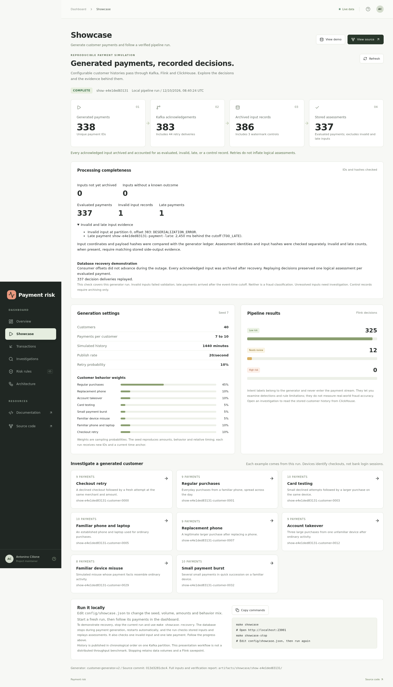
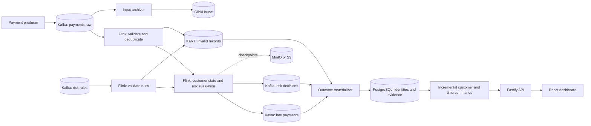

# Payment risk

A payment monitoring application built with Apache Flink, Kafka, PostgreSQL and React. It evaluates reported card authorization attempts against customer activity, stores the assessment and its supporting evidence, and provides a dashboard for investigation.

The system classifies risk after receiving an authorization result. It does not approve purchases, block payments or move money. A configurable generator sends artificial customer histories through the same pipeline used by the live application.

[View the dashboard demo](https://acilione.github.io/payment-risk/)

## Contents

- [Quick setup](#quick-setup)
- [Quick start](#quick-start)
- [Showcase walkthrough](#showcase-walkthrough)
- [Architecture](#architecture)
- [Flink processing](#flink-processing)
- [Data generation](#data-generation)
- [Data model](#data-model)
- [Storage and delivery guarantees](#storage-and-delivery-guarantees)
- [Dashboard and API](#dashboard-and-api)
- [Development and configuration](#development-and-configuration)
- [Operations](#operations)
- [Deployment](#deployment)
- [Tests and CI](#tests-and-ci)
- [Performance](#performance)

## Quick setup

Install Git, Make and Python **3.10+**, with a running Docker daemon and **Docker Compose v2**. Allow at least **8 GB of available memory** and **15 GB of free disk space**. Build containers supply Java, Maven and Node.js.

```bash
git --version
make --version
python3 --version
docker compose version
docker info

git clone https://github.com/acilione/payment-risk.git
cd payment-risk
```

## Quick start

```bash
make showcase
```

This creates local credentials in `.env`, builds the images, starts the services, registers schemas, initializes PostgreSQL and the ClickHouse input archive and submits the Flink job. It then generates payments and verifies their stored results. The first build needs internet access and can take several minutes.

Open **http://localhost:23001** and select **Showcase**. When the command finishes, the run should show **COMPLETE**. Select a customer example to inspect its timeline, risk score and rule evidence.

The report is saved to `artifacts/showcase/latest.json`. Each run also retains its configuration, acknowledged inputs, logs, reconciliation ledger and dashboard snapshot under `artifacts/showcase/<run-id>/`.

To stop the showcase:

```bash
make showcase-stop
```

Stopping requests a non-draining Flink savepoint and preserves Kafka, database and object-storage volumes. Subsequent runs use fresh topics, consumer groups and payment IDs while retaining previous results.

| Problem                                   | Action                                                                                         |
| ----------------------------------------- | ---------------------------------------------------------------------------------------------- |
| Docker cannot be reached                  | Start Docker and confirm `docker info` succeeds.                                               |
| A previous showcase is running            | Finish or interrupt its command, then run `make showcase-stop`.                                |
| The regular stack occupies the same ports | Run `make stop-job` if its Flink job is active, then `make down`.                              |
| A build or service fails                  | Check disk space, available memory and logs. Keep `.env` when reusing existing volumes.        |
| Verification reports `FAILED`             | Inspect the report and `producer.log` in the run directory; failed runs preserve their inputs. |

## Showcase walkthrough



Use the completed run to demonstrate three aspects of the application:

1. **Processing completeness.** In Showcase, compare acknowledged deliveries, archived records and logical assessments. Transport retries increase the delivery count without adding another assessment.
2. **Investigation.** Open **Account takeover**, select a payment and examine the observations and score contribution of each rule. Compare it with **Replacement phone**, a legitimate change that can trigger review, and **Familiar device misuse**, whose suspicious intent is not visible in the payment fields.
3. **Analytical views.** Use Overview for totals and Transactions for filtering. These live screens include retained results across runs; Showcase and its customer links identify the selected run. Small custom runs may not include every behavior.

### Outage and recovery

```bash
make showcase-stop
make showcase-recovery
```

The recovery command starts a fresh run, stops PostgreSQL and ClickHouse and continues publishing through Kafka and Flink. It keeps the outage visible for 20 seconds before restarting the database. It checks that archive and output-consumer offsets did not advance while storage was unavailable, waits for catch-up, and replays committed assessments to verify stable logical counts. Both databases are restarted even if the command fails or is interrupted.

The [recovery evidence](docs/evidence/postgres-recovery.json) and [outage screenshot](docs/images/database-outage.png) record this procedure. It tests temporary database unavailability, not replicated storage or disk-loss recovery.

The run verifier in [showcase.py](scripts/showcase.py) maintains a disk-backed SQLite ledger and compares acknowledged source coordinates and wire hashes against archived records. Assessments and late outcomes must match the payment's business-input fingerprint; invalid records match their original Kafka coordinates and wire hash. Identical retry deliveries share one logical outcome, and watermark controls are accounted for separately. Missing records, contradictory evidence or quarantined outputs prevent completion.

This verification covers the selected generator run. Dashboard totals alone do not establish input completeness, and an archived input can still be pending evaluation. During an outage, storage counts are unavailable; during generation, counts remain provisional.

If publishing finished but verification timed out, restore the services and run `make showcase-reconcile`. It checks the retained ledger without producing another run and refuses completion if the acknowledgement log is incomplete. To exercise invalid and late outcomes without an outage, stop the previous run and use `python3 scripts/showcase.py run --include-outcomes`.

### Export the static demo

```bash
make showcase-export
npm --prefix web ci
npm --prefix web run format
VITE_DEMO_MODE=true npm --prefix web run build
npm --prefix web run preview
```

Export reads a successfully verified SQLite reconciliation ledger. The [committed snapshot](web/src/showcase-data.json) contains at most 1,000 evaluated payments, preserving each selected customer's complete assessed history, policy evidence, generator settings and reconciliation counts. Overview, Transactions and Investigations derive their static content from that same snapshot; the browser does not run the risk evaluator. Invalid and late records appear in the completeness report, not as invented assessments.

Static mode makes no requests to the local services and marks operational telemetry as unmeasured. Its time windows use payment event time so the saved demonstration remains useful. Live mode uses evaluation time and never substitutes sample data after a failure.

## Architecture



[PaymentRiskJob](src/main/java/com/portfolio/paymentrisk/PaymentRiskJob.java) assembles the stream operators. Kafka separates payment intake, stateful evaluation and database writes, so a database outage can accumulate a backlog without requiring Flink to call the database. The input archiver is an independent consumer: it preserves original records even when validation or risk processing cannot complete.

Payment and decision topics have three partitions locally. Live producers use the UTF-8 `customer_id` as the Kafka key and leave partition selection to Kafka's default keyed partitioner; the CLI, load generator and decision sink follow the same contract. Changing the partition count can change a customer's partition. Flink's `keyBy` independently assigns managed state, including the separate event-ID and transaction-ID checks.

| Technology                                    | Responsibility                                                                                         |
| --------------------------------------------- | ------------------------------------------------------------------------------------------------------ |
| Java 17 bytecode; Java 21 containers          | Flink application, rule calculation, producers and database consumers.                                 |
| Apache Flink 2.2.1                            | Keyed customer state, event-time timers, broadcast rules and checkpoint-coordinated output.            |
| Apache Kafka 4.3.1; Flink connector 5.0.0-2.2 | Durable input/output topics and transactional delivery.                                                |
| Avro 1.12.1; Apicurio Registry 3.3.2          | Wire contracts and writer-schema resolution. PostgreSQL persists registry metadata.                    |
| Embedded RocksDB; MinIO/S3                    | Local keyed state and remote incremental checkpoints/savepoints.                                       |
| PostgreSQL 18.6                               | Durable assessment identities, conflict records, evidence and transactional summaries.                 |
| ClickHouse 26.8.2.7                           | Independent archive of original input deliveries; retained historical output tables support migration. |
| React 19, TypeScript, Vite 8                  | Dashboard components and static build; SVG/CSS charts.                                                 |
| Node.js 24; Fastify 5                         | Read-only HTTP API with indexed PostgreSQL reads.                                                      |
| Prometheus 3; Grafana 13                      | Pipeline metrics, alert rules and provisioned dashboards.                                              |
| Docker Compose, Helm, Terraform               | Local services, Kubernetes Flink deployment and S3 state storage.                                      |

The code separates processing responsibilities:

| Component                                              | Owns                                                                              |
| ------------------------------------------------------ | --------------------------------------------------------------------------------- |
| `source/`, `serialization/`, `Validate`, `Deduplicate` | Wire decoding, field validation and input identity checks.                        |
| `CustomerRiskProcessor`                                | Payment admission, event-time callbacks and coordination of customer state.       |
| `PendingPayments`, `StateHistory`, `StateExpiryIndex`  | Buffered records, retained observations and timed cleanup.                        |
| `RollingFeatures`, `RiskFeatures`, `RiskEngine`        | Feature calculation and scoring; no database or network calls.                    |
| `PaymentArchiver`, `DecisionMaterializer`, `storage/`  | Durable inserts, bounded batches, retries and consumer offset commits.            |
| `web/server/`                                          | Snapshot-consistent analytical reads and HTTP handling.                           |
| `web/src/features/`                                    | Overview, transactions, investigations, showcase, rules and architecture screens. |

## Flink processing

### Validation and identity

[RawDeserializer](src/main/java/com/portfolio/paymentrisk/source/RawDeserializer.java) resolves and decodes the Avro writer schema through [AvroCodec](src/main/java/com/portfolio/paymentrisk/serialization/AvroCodec.java). Validation happens before source timestamp assignment, preventing malformed or far-future events from moving the watermark.

[Validate](src/main/java/com/portfolio/paymentrisk/processor/Validate.java) requires nonblank identifiers of at most 128 characters, a positive amount no greater than 1,000,000,000,000 cents, EUR currency, an ISO country code and a supported authorization status. Event time must be positive and no more than five minutes ahead of the validation clock. Payloads above 1 MiB are rejected. Invalid payments and rules go to `payments.dlq`; registry connectivity or authentication failures trigger recovery instead of being reported as invalid business data.

Valid payments pass through two keyed identity checks: first `keyBy(event_id)`, then `keyBy(transaction_id)`. These repartitions let the checks detect reused identities even if the incoming `customer_id` changes. [Deduplicate](src/main/java/com/portfolio/paymentrisk/processor/Deduplicate.java) compares event fingerprints excluding `producer_time`; the transaction check compares canonical business fields excluding both `producer_time` and `event_id`. A republished event with a new event ID therefore remains the same transaction. An identical retry is suppressed; changed content under an existing identity fails processing. Both indexes expire after 24 hours of processing time by default (`DEDUP_TTL_MS`), including downtime; reads do not extend retention. This bounds live state and is not permanent business uniqueness.

### Admission and event-time ordering

The next `keyBy(customer_id)` sends one customer's records to the same processing subtask. [CustomerRiskProcessor](src/main/java/com/portfolio/paymentrisk/processor/CustomerRiskProcessor.java) then:

1. Compares the event timestamp with the current watermark and the customer's checkpointed finalization cutoff. An event at or behind either cutoff goes to `payments.late` and does not change history.
2. Captures the applicable rules, classification thresholds and policy identity alongside the payment in managed pending state.
3. Registers an event-time timer for that timestamp. When the watermark reaches it, the callback sorts pending payments at that timestamp by `event_id`.
4. Expires obsolete features and history using the timer's logical time, evaluates each payment in order, emits its assessment, then records its amount, device and status for subsequent evaluations.

This order matters: the current payment is added to observations once, and an earlier payment with the same timestamp is visible to the next payment in event-ID order. A watermark jump cannot delete history needed by an older pending timer.

The payment source allows ten seconds of out-of-order arrival (`OUT_OF_ORDER_MS`). Partitions become idle after sixty seconds (`IDLE_TIMEOUT_MS`); the minimum watermark of active partitions controls progress. The rule stream marks itself idle because it does not define payment time. If all payment partitions are idle, the remaining buffered tail waits for new input. A processing-time watchdog reports overdue queues without forcing evaluation.

The saved per-customer cutoff prevents restored source watermarks from reopening finalized history. Late payments retain their original content and lateness as a separate outcome; the application does not revise earlier scores automatically.

### Risk observations and scoring

For a payment at time `t`, each rule observes the interval **`(t - window, t]`**. The lower boundary is excluded. All authorization attempts contribute to count, amount and device observations, including declined attempts; the fifth rule separately checks preceding declines and the current status.

| Rule                                     | Observation and default match condition                                                                                                               | Points |
| ---------------------------------------- | ----------------------------------------------------------------------------------------------------------------------------------------------------- | -----: |
| R001: payment frequency                  | Count the current attempt and preceding attempts in 2 minutes; match when the count is **greater than 5**.                                            |     25 |
| R002: total amount                       | Sum the current amount and same-currency history in 10 minutes using integer cents; match above **EUR 3,000**.                                        |     35 |
| R003: device count                       | Count distinct devices, including the current device, in 15 minutes; match at **3 or more**.                                                          |     20 |
| R004: unfamiliar device and large amount | Check the device's last evaluated timestamp before updating it; match when it was not seen within **30 days** and the amount is **at least EUR 800**. |     30 |
| R005: approval after declines            | Require current status `APPROVED` and **at least 4** preceding `DECLINED` attempts in 10 minutes. Declines need not be consecutive.                   |     40 |

[RiskEngine](src/main/java/com/portfolio/paymentrisk/domain/RiskEngine.java) adds the weights of enabled, eligible matching rules and caps the score at 100. Default classifications are:

| Score  | Dashboard label | Stored code |
| ------ | --------------- | ----------- |
| 0-29   | Low risk        | `APPROVE`   |
| 30-69  | Needs review    | `REVIEW`    |
| 70-100 | High risk       | `REJECT`    |

For example, a EUR 900 purchase on an unfamiliar device contributes 30 points through R004 and receives Needs review if no other rule matches. If four recent declined attempts used that same device before the purchase, R005 contributes 40 points while R004 no longer matches: the device has already been observed. The engine uses recorded payment facts rather than a scenario's intended label.

Each assessment records every rule, including nonmatches: observed value, threshold, eligibility, enablement, match and score contribution. It also retains the policy snapshot and fingerprint so an investigator can explain the result without consulting the currently deployed rules. These are deterministic rule scores, not learned fraud probabilities.

### State and bounded computation

| Managed state                          | Contents                                                                           | Default bound                                                   |
| -------------------------------------- | ---------------------------------------------------------------------------------- | --------------------------------------------------------------- |
| Pending payments                       | Individual payment records, admission-time policy snapshots and timestamp links.   | 100,000 pending records per customer.                           |
| History                                | Timestamp buckets containing event time, amount, currency, device and status.      | One hour of event time; 100,000 retained payments per customer. |
| Devices                                | Device ID to last evaluated timestamp.                                             | Thirty days of event time; 10,000 devices per customer.         |
| Rolling features                       | Window positions, counts, amount sums, decline counts and device reference counts. | Limited to configured rule windows.                             |
| Expiry indexes and finalization cutoff | References for timed cleanup and the customer's evaluated time frontier.           | Cleared as the corresponding customer data expires.             |

For fewer than 64 retained payments, [RiskFeatures](src/main/java/com/portfolio/paymentrisk/domain/RiskFeatures.java) computes observations in one pass over a lazy history iterator. It does not copy the complete history into a list. For denser histories, [RollingFeatures](src/main/java/com/portfolio/paymentrisk/processor/RollingFeatures.java) maintains exact aggregates and device reference counts; expired entries are subtracted as event time advances. A change to a rule's type, currency or window rebuilds that aggregate from retained history. Incremental state remains active until history and pending records are empty.

Pending admission stores records individually instead of rewriting a growing timestamp bucket. [StateExpiryIndex](src/main/java/com/portfolio/paymentrisk/processor/StateExpiryIndex.java) indexes history and device expiry, avoiding a scan of all customer devices for each payment. Timer callbacks keep counters locally while evaluating a timestamp group and persist them once at completion; per-payment state limits still apply. A per-subtask cache holds at most 32 prepared policies containing sorted rules, their fingerprint and canonical audit JSON. It is derived, transient state and is rebuilt after restoration.

Admission also reuses the rule snapshot until an accepted broadcast update invalidates it. Each queued payment still stores its own snapshot. Canonical audit JSON sorts object keys recursively and serializes once, avoiding repeated parsing of nested fields; deduplication computes transaction facts only at the transaction-identity stage and reuses state values within each call.

These bounds do not eliminate all concentrated work: a complete same-timestamp group is still sorted and evaluated in one callback, and one customer's state belongs to one subtask. Exceeding a pending, history or device limit fails the job rather than discarding observations and producing an incomplete score.

### Policy selection

Local mode supports updates from the compacted `risk.rules` topic. Broadcast state distributes accepted rules to every customer-processing subtask. An update must have a higher version; equal or older versions are ignored. Disabling a rule requires a higher version with `enabled: false`. `updated_at` is metadata, not an activation schedule.

A payment keeps the policy captured when it enters pending state. Later updates affect newly admitted payments. Payment and rule topics have no shared ordering, so replay after a checkpoint can change which dynamic policy is seen by an uncheckpointed payment.

Staging and production therefore require an immutable catalog loaded by [PolicyCatalog](src/main/java/com/portfolio/paymentrisk/domain/PolicyCatalog.java) from `POLICY_FILE` or `POLICY_CATALOG_JSON`. It includes all five rules, thresholds, policy ID and version; [policy-default.json](config/policy-default.json) is an example. Catalog mode ignores broadcast updates, and releasing a policy requires a versioned deployment. Helm requires an immutable ConfigMap and exact `POLICY_SHA256`. The checksum verifies content, not authorship.

### Checkpoints and output

Embedded RocksDB holds keyed state. Incremental checkpoints copy it to MinIO in Compose or S3 in Kubernetes. Flink restores source positions, pending records, customer history, broadcast state and timers together. State uses explicit serializers and stable operator UIDs with maximum parallelism 128; changing a state descriptor or its JSON meaning requires a tested migration.

The decision, invalid-record and late-event sinks each use Kafka `EXACTLY_ONCE` delivery. Flink makes their transactions visible after completed checkpoints; downstream consumers use `read_committed`. This guarantee covers Kafka input, Flink state and transactional Kafka output. Database inserts are a separate durability boundary, explained below.

## Data generation

### Customer behavior model

[GeneratedPayments](src/main/java/com/portfolio/paymentrisk/tools/generation/GeneratedPayments.java) uses `SplittableRandom` and a configuration seed to assign each customer a behavior, payment count and independent random sequence. It builds a baseline history, then applies the selected behavior to the final purchases.

Each customer has a stable merchant country, a small set of merchants and a familiar phone. Ordinary amounts favor the lower end of the configured range by taking the smaller of two uniform samples. Timestamps vary within non-overlapping chronological slots; selected behaviors create a short final sequence. `device_id` identifies the checkout device or browser, not an active bank login.

| Profile          | Default weight | Generated behavior                                                                                                                               |
| ---------------- | -------------: | ------------------------------------------------------------------------------------------------------------------------------------------------ |
| `normal`         |            45% | Ordinary purchases on a familiar phone, spread across the history.                                                                               |
| `known_devices`  |            10% | Purchases from a familiar phone and laptop.                                                                                                      |
| `checkout_retry` |            10% | A decline followed 45-120 seconds later by an approved attempt with the same merchant, amount and device. Each attempt has a new transaction ID. |
| `new_device`     |            10% | An ordinary history followed by a larger purchase on a replacement phone.                                                                        |
| `takeover`       |            10% | Three large purchases within 3-6 minutes from one unfamiliar device.                                                                             |
| `card_testing`   |             5% | Four small declined attempts from an unfamiliar device, then a larger approved purchase.                                                         |
| `low_burst`      |             5% | Five small purchases close together on a familiar device.                                                                                        |
| `trusted_device` |             5% | A purchase with suspicious simulated intent whose observable fields resemble ordinary behavior.                                                  |

These are configurable simulations, not sampled bank records or validated fraud statistics. The default weights emphasize investigation cases. Labels and behavior names remain in generator metadata and never enter the payment schema or risk calculation. The older authored histories in `customer-scenarios.json` are regression fixtures, not the dashboard's data source.

### Configuration and reproducibility

After stopping the previous showcase, copy and edit the configuration:

```bash
cp config/showcase.json config/my-showcase.json
make showcase SHOWCASE_CONFIG=config/my-showcase.json
```

| Setting in [showcase.json](config/showcase.json) | Default            | Meaning                                                                                 |
| ------------------------------------------------ | ------------------ | --------------------------------------------------------------------------------------- |
| `seed`                                           | `7`                | Reproduces behavior selection, amounts, relative timestamps and retry choices.          |
| `customers`                                      | `40`               | Number of customer histories; maximum 2,000.                                            |
| `min_payments` / `max_payments`                  | `7` / `10`         | Attempts per customer; range 7-100, at most 100,000 per run.                            |
| `history_minutes`                                | `1440`             | Simulated duration; range 5-1,440 minutes. Short histories compress behavior sequences. |
| `publish_rate`                                   | `20`               | Target unique payments per second; independent of simulated elapsed time.               |
| `retry_percent`                                  | `10`               | Probability of another byte-identical transport delivery.                               |
| `ordinary_amount_min` / `ordinary_amount_max`    | `250` / `15000`    | Ordinary purchase range in cents.                                                       |
| `large_amount_min` / `large_amount_max`          | `80000` / `150000` | Large purchase range in cents.                                                          |
| `profiles`                                       | Weights above      | Integer probabilities totaling 100; zero disables a profile.                            |

A new run receives a fresh ID prefix and current time anchor. The same seed reproduces the relative history, not identical wall-clock timestamps or IDs. Profile weights are probabilities, so a run's observed mix can differ from the configured percentages.

### Publishing and transformation

The generator keeps one pending payment per customer in a priority queue and merges histories in timestamp order. Memory grows with the number of customers rather than the full payment count.

[ShowcaseProducer](src/main/java/com/portfolio/paymentrisk/tools/ShowcaseProducer.java) takes the generated event and transaction IDs, sets `producer_time`, serializes each payment as Avro and sends it to Kafka with `acks=all`, idempotence and Zstandard compression. A transport retry sends exactly the same bytes and IDs. It is distinct from a customer's fresh checkout attempt.

Live-load generation runs in a separate container limited to one CPU and 512 MiB, with a 256 MiB JVM heap. Its acknowledgement reader writes the verification ledger without pausing for database progress queries. The intended send timestamp is recorded separately from the payment, so producer delays remain measurable.

There are two publishing modes:

| Mode      | Event time and partitioning                                                                                                    | Purpose                                                                                                                              |
| --------- | ------------------------------------------------------------------------------------------------------------------------------ | ------------------------------------------------------------------------------------------------------------------------------------ |
| Showcase  | Preserves generated historical timestamps; sends business payments chronologically on one partition with one outstanding send. | Reproducible behavioral timelines without accelerated history overtaking across source partitions.                                   |
| Live load | Uses current event timestamps and Kafka's default customer-keyed partitioning, with at most 512 outstanding sends.             | Measures pipeline throughput and latency. Compressed timing changes the behavioral windows, so this is not a scenario-accuracy test. |

For a finite run, the producer waits until a source checkpoint covers the generated history, then sends a reserved `showcase-control-` record to each partition to advance watermarks. Controls use ordinary payment records but are excluded from business counts and customer examples. With `--include-outcomes`, the producer also sends malformed bytes and a deliberately late payment after observing a committed assessment for that customer.

The data changes representation at each boundary:

| Stage                  | Representation                                                                                    |
| ---------------------- | ------------------------------------------------------------------------------------------------- |
| Generation             | Customer plan and payment objects; scenario labels remain separate.                               |
| Kafka input            | Avro payment bytes, customer key, headers and source coordinates.                                 |
| Flink pending state    | Decoded payment plus captured policy and ordering metadata.                                       |
| Flink retained history | Only the time, amount, currency, device and status needed by later rules.                         |
| Kafka output           | Assessment with score and evidence, or an invalid/late outcome.                                   |
| PostgreSQL             | Unique initial assessments, physical delivery evidence, outcomes and incremental summaries.       |
| ClickHouse             | Original input bytes, independently archived.                                                     |
| Dashboard              | Bounded totals, customer pages and assessment evidence read through the API or exported snapshot. |

## Data model

The domain represents one authorization result per transaction. A customer has many transactions; a fresh authorization attempt receives a new transaction ID, while a transport retry retains its identity. Capture, refund and transaction revision events are outside the current contract. Customer, merchant and device IDs are producer-supplied references; there are no separate master-data tables for them.

### Payment contract

The [Transaction schema](schemas/transaction.avsc) contains:

| Fields                                    | Type and meaning                                                                   |
| ----------------------------------------- | ---------------------------------------------------------------------------------- |
| `event_id`, `transaction_id`              | Strings identifying the event and authorization attempt.                           |
| `customer_id`, `merchant_id`, `device_id` | String references used to associate the payment with its origin.                   |
| `amount_minor`, `currency`                | Avro `long` in minor units and currency string; `12345` EUR means EUR 123.45.      |
| `country`                                 | Merchant country in the showcase model.                                            |
| `status`                                  | Enum `APPROVED` or `DECLINED`, supplied by the upstream authorization source.      |
| `event_time`                              | Epoch milliseconds with Avro `timestamp-millis`; drives ordering and rule windows. |
| `producer_time`                           | Producer-supplied epoch milliseconds for delivery timing.                          |

Merchant and country remain in the archive and canonical transaction facts, but are not used by the five rules.

### Assessment and identity

The [RiskDecision schema](schemas/risk-decision.avsc) carries the input event, transaction and customer IDs, amount, currency, event time, risk score, classification, matched rule IDs and corresponding rule types. `processed_at` records evaluation time, not a business revision or database commit.

Audit fields include `engine_version`, `policy_id`, `policy_version`, `policy_snapshot`, `rules_fingerprint`, `rule_evidence` and `input_sha256`. The policy fingerprint hashes the complete rule settings and classification thresholds in canonical order; the input hash ties the result to the business facts.

`decision_id` is `risk_` followed by the transaction ID. `evaluation_id` is `eval_` followed by SHA-256 of the canonical tuple `(event_id, engine_version, policy_id, policy_version)`. Result content, processing time and delivery coordinates are deliberately excluded from that identity, allowing different results under the same identity to be detected as a conflict. Historical records with missing audit fields use schema defaults; missing evidence is displayed as unavailable.

The authoritative storage key is `(source_system, transaction_id, assessment_request_id)`. The current contract permits only the stable request `initial`; engine and policy versions are evidence, not permission to create another payment. `PAYMENT_SOURCE_SYSTEM` is a deployment-level business namespace, independent of Kafka topic names. The present stream assumes one source namespace per deployment.

`transaction_facts` contains canonical payment fields excluding transport event ID and producer time. This lets storage compare full business content when an upstream retry changes its event ID. Evaluation and event aliases also have unique mappings, preventing one identity from being reassigned to another transaction. Conflicting facts, rules or observations are preserved as incidents; the accepted assessment is not overwritten. Legacy assessments without full facts retain the stricter input-fingerprint comparison.

### Other contracts

| Schema                                 | Contents                                                                                                                                                                                                                                             |
| -------------------------------------- | ---------------------------------------------------------------------------------------------------------------------------------------------------------------------------------------------------------------------------------------------------- |
| [RiskRule](schemas/risk-rule.avsc)     | Rule ID, version, type, enablement, points, lookback duration, threshold, currency and update timestamp.                                                                                                                                             |
| [DeadLetter](schemas/dead-letter.avsc) | Original topic/partition/offset, schema ID, error code, observation time, wire-payload hash and length. `error_id` is the source coordinate tuple. Raw payload is omitted by default; local capture mode retains at most a 4,096-byte Base64 prefix. |
| [LateEvent](schemas/late-event.avsc)   | Original decoded payment as JSON, customer ID, effective cutoff, lateness, observation time and `TOO_LATE` reason.                                                                                                                                   |

Timestamps are epoch milliseconds, window durations are seconds, and amounts use integer arithmetic. The five schemas and their historical reader-compatibility fixtures are in [schemas/](schemas/).

| Topic            | Value        | Kafka key                               |
| ---------------- | ------------ | --------------------------------------- |
| `payments.raw`   | Transaction  | `customer_id` in the provided producers |
| `risk.rules`     | RiskRule     | `rule_id`                               |
| `risk.decisions` | RiskDecision | `customer_id`                           |
| `payments.dlq`   | DeadLetter   | `error_id`                              |
| `payments.late`  | LateEvent    | `customer_id`                           |

Values use Confluent-compatible framing: zero magic byte, four-byte schema ID, then Avro binary data. Registry subjects use `<topic>-value`; keys are UTF-8. The Flink source reads identifiers from the value and does not validate the input key. Bootstrap creates three partitions per topic except the single-partition compacted rule topic, and leaves existing topic configuration unchanged.

## Storage and delivery guarantees

### Archive and materialization

[PaymentArchiver](src/main/java/com/portfolio/paymentrisk/tools/PaymentArchiver.java) consumes the input topic with its own group. It preserves exact keys, values, headers, null flags, Kafka timestamps, source coordinates and payload hashes in `risk.payment_ingress`. Binary values are Base64-encoded and compressed; decoding Avro later also requires retained registry metadata.

[DecisionMaterializer](src/main/java/com/portfolio/paymentrisk/tools/DecisionMaterializer.java) consumes committed assessments, invalid records and late records. [DurableKafkaBatch](src/main/java/com/portfolio/paymentrisk/storage/DurableKafkaBatch.java) bounds shared buffering by bytes, rows and age, and flushes at the end of every poll. A row larger than the batch byte limit is written alone without truncation. Each chunk commits only its covered Kafka offsets, after all synchronous inserts succeed.

[PostgresWriter](src/main/java/com/portfolio/paymentrisk/storage/PostgresWriter.java) sends bounded batches to the acceptance function in [postgres.sql](infrastructure/docker/postgres.sql). Within a database transaction, it records delivery coordinates, validates business identities, inserts each new initial assessment once, and updates only the affected customer, ten-second time buckets, rule counts and latency histogram. An uncertain commit can be retried: an existing delivery or identical assessment does not increment summaries again. Database failures leave Kafka offsets uncommitted. Invalid outputs and conflicting results are persisted before their offsets advance and block dashboard reads.

The independent archive still uses [ClickHouseWriter](src/main/java/com/portfolio/paymentrisk/tools/ClickHouseWriter.java), with bounded retries and no dependency on successful risk evaluation. The assessment writer does not wait for ClickHouse during normal operation.

### Database organization

| PostgreSQL table                                  | Purpose                                                                                      |
| ------------------------------------------------- | -------------------------------------------------------------------------------------------- |
| `assessments`                                     | One accepted initial assessment per source system and transaction, with full evidence.       |
| `identity_aliases`                                | Unique event/evaluation identities mapped to their transaction.                              |
| `deliveries`, `outcomes`                          | Source-coordinate evidence and invalid/late output records.                                  |
| `incidents`                                       | Conflicting deliveries, identities or malformed outputs; unresolved entries block analytics. |
| `customer_totals`, `customer_versions`            | Incremental totals and versions used for stable investigation pages.                         |
| `time_buckets`, `rule_buckets`, `latency_buckets` | Compact summaries updated when a logical assessment is first accepted.                       |
| `topic_totals`, `projection_status`               | Incremental ingestion counters and migration readiness.                                      |

PostgreSQL B-tree indexes enforce identities on disk. They do not require every transaction key to reside in memory. Customer/time and topic/event indexes support bounded timeline and reconciliation reads. Indexes, immutable delivery evidence and customer versions grow with retained history; no automatic deletion weakens identity protection.

ClickHouse's `payment_ingress` table remains the original input archive. Its older assessment and serving tables are retained for migration and historical diagnostics; normal dashboard refreshes do not read or rebuild them. The old publisher is disabled by default behind the `legacy-analytics` Compose profile.

### Retention and recovery boundary

Both database consumers use `auto.offset.reset=none`. A new local group starts at zero only when the retained beginning is zero; otherwise startup fails. Existing out-of-range offsets also fail. Other environments require explicitly provisioned offsets.

New input topics disable automatic time/size retention, and the raw archive has no automatic TTL. Source segments must not be removed before verified archive coverage and Flink recovery requirements permit it. Output topics retain their seven-day default. Disk capacity, schema backups and storage replication remain operational responsibilities; the local single-broker, single-database stack cannot tolerate disk loss by itself.

## Dashboard and API

### Incremental serving

The [PostgreSQL reader](web/server/postgres-reader.mjs) reads maintained summaries instead of grouping retained assessments. Overview combines ten-second buckets in the requested interval; latest-payment and customer-timeline queries use ordered indexes and row limits. Monetary totals and counts are exact. Time-window boundaries round down to ten seconds, and the latency p95 is a labeled upper-bound estimate from a logarithmic histogram.

Each API operation uses a read-only repeatable-read transaction. Investigation cursors contain a signed database snapshot and expire after two minutes. Assessment insertion transaction IDs and versioned customer summaries preserve that snapshot across pages. New arrivals cannot alter an in-progress timeline. Readiness and unresolved incidents are checked on every request, including requests with older cursors.

There is no periodic canonical-copy publication and no global historical integrity query in the normal serving path. Reconciliation reads only the selected run and must inspect every expected input to establish completeness; one-time migration and deliberate audits can still read historical data. **Data as of** describes database visibility, not proof that Kafka has no backlog.

### Queries and interface

| Endpoint or view                          | Behavior                                                                                                                                                        |
| ----------------------------------------- | --------------------------------------------------------------------------------------------------------------------------------------------------------------- |
| `/api/overview?window=15m`, `1h` or `24h` | Counts, amounts, trend buckets, rule matches and latest 100 decisions, filtered by `processed_at`. Browser transaction filters apply to those loaded decisions. |
| `/api/investigations/customers`           | Customer-ID prefix search and classification filter, up to 20 rows per page.                                                                                    |
| `/api/investigations/timeline`            | Customer assessments ordered by event time and transaction ID, with recorded policy and rule evidence.                                                          |
| Rules screen                              | Packaged defaults; it is not a live rule-state viewer or editor.                                                                                                |

Investigation cursors also pin search scope. Expired cursors require a new search, and an unresolved incident blocks older cursors. Timeline provenance identifies the output Kafka delivery; original input coordinates are retained in the archive. Timelines contain assessed payments only.

[Fastify](web/server/app.mjs) serves fixed, parameterized SQL with query deadlines, a bounded connection pool, security headers and rate limiting. The website container has a 256 MiB memory limit. Concurrent overview requests share work, and the browser polls every fifteen seconds. Errors return 503 and leave previously displayed data visibly stale.

The API also queries Flink REST and Prometheus for job, checkpoint and source-lag status. Failed health probes do not replace successful analytical results. Finalization latency measures `processed_at - event_time`, excluding later Kafka commit and database waits.

The React application groups screens under `features/`, shared UI under `components/`, subscriptions under `hooks/`, and API/formatting helpers under `lib/`. Request cleanup cancels obsolete reads and polling waits for each response before scheduling another. Investigation selection is derived from the current timeline instead of keeping a second copy of the selected payment.

The local API is unauthenticated and intended for generated data. A deployment serving real payment information needs authentication, authorization and restricted database access. Analyst notes, case ownership and editable case states are not implemented.

## Development and configuration

### Manual startup

For Java development, install Java 17 or later and Maven. Use the Node version in [web/.nvmrc](web/.nvmrc) for frontend work. To start the regular Compose project instead of the showcase:

```bash
make up
make run-job
make generate-load
```

`make generate-load` sends 10,000 payments at a requested 100 events/second. `make build` runs Maven verification and creates `target/risk-engine.jar`; `make image-local` builds the runtime image from that tested JAR. `make down` stops services while preserving volumes; save the active Flink job first with `make stop-job`. `make website` rebuilds the website against existing services.

| Service                           | Local address                          |
| --------------------------------- | -------------------------------------- |
| Dashboard                         | http://localhost:23001                 |
| Flink                             | http://localhost:28082                 |
| Grafana                           | http://localhost:23000                 |
| Prometheus                        | http://localhost:29090                 |
| Schema Registry compatibility API | http://localhost:28081/apis/ccompat/v7 |
| ClickHouse HTTP                   | http://localhost:28123                 |
| PostgreSQL                        | `localhost:25432`                      |
| MinIO console                     | http://localhost:29001                 |
| Kafka                             | `localhost:29092`                      |

Grafana uses `admin` and `GRAFANA_ADMIN_PASSWORD` from `.env`. Compose binds exposed ports to localhost. Service credentials stay on the server; frontend `VITE_*` values become public JavaScript and must not contain secrets.

For frontend development, stop the Compose website and start Vite:

```bash
docker compose stop website
npm --prefix web ci
npm --prefix web run dev
```

In a second terminal, run `node --env-file=.env web/server/index.mjs`. Vite serves port 23001 and proxies `/api` to port 23002; keep PostgreSQL and the materializer running. The API uses the local PostgreSQL port and `RISK_DB_PASSWORD` from `.env`.

### Application settings

[AppConfig](src/main/java/com/portfolio/paymentrisk/config/AppConfig.java) validates job settings. [BatchLimits](src/main/java/com/portfolio/paymentrisk/storage/BatchLimits.java) and [KafkaIngestion](src/main/java/com/portfolio/paymentrisk/storage/KafkaIngestion.java) define database-consumer limits. The main connection and ingestion settings are:

| Variable                                              | Default or requirement                                                                                  |
| ----------------------------------------------------- | ------------------------------------------------------------------------------------------------------- |
| `KAFKA_BOOTSTRAP_SERVERS`                             | `localhost:29092`                                                                                       |
| `SCHEMA_REGISTRY_URL`                                 | `http://localhost:28081/apis/ccompat/v7`                                                                |
| `KAFKA_GROUP`                                         | `payment-risk-v1`; sources add `-payments` and `-rules`                                                 |
| `TRANSACTIONAL_PREFIX`                                | `payment-risk-local-v1`; must differ between active deployments                                         |
| `STARTUP_OFFSETS`                                     | `earliest` locally; production payment input requires `committed`                                       |
| `APP_ENVIRONMENT`                                     | `local`; production also requires HTTPS registry access and Kafka `SSL` or `SASL_SSL`                   |
| `KAFKA_PROPERTIES_FILE` / `REGISTRY_BEARER_TOKEN`     | Optional mounted Kafka settings and registry authentication secret                                      |
| `CLICKHOUSE_URL` / `CLICKHOUSE_USER`                  | `http://localhost:28123` / `risk`; Compose supplies its internal URL                                    |
| `CLICKHOUSE_PASSWORD`                                 | Required secret; database consumers require HTTPS outside local mode                                    |
| `RISK_JDBC_URL` / `RISK_DB_PASSWORD`                  | PostgreSQL JDBC endpoint and required secret; use `sslmode=verify-full` outside local mode.             |
| `PAYMENT_SOURCE_SYSTEM`                               | Stable business namespace, default `payment-risk`; do not change it for a retry or topic migration.     |
| `MATERIALIZER_GROUP` / `ARCHIVER_GROUP`               | `risk-clickhouse-evaluations-v2` / `risk-payment-archive-v1`                                            |
| `INGEST_BATCH_BYTES` / `INGEST_BATCH_ROWS`            | 1 MiB / 1,000 rows                                                                                      |
| `INGEST_BATCH_MS` / `INGEST_MAX_POLL_RECORDS`         | 1,000 ms buffered age / 250 records; age is checked on admission and is not a database request deadline |
| `PENDING_ALERT_MS`                                    | `60000`                                                                                                 |
| `MATERIALIZER_METRICS_PORT` / `ARCHIVER_METRICS_PORT` | `9405` / `9406`                                                                                         |

State retention and limits are configurable through `HISTORY_MS`, `DEVICE_HISTORY_MS`, `MAX_EVENTS_PER_CUSTOMER` and `MAX_DEVICES_PER_CUSTOMER`. Rule windows must fit retained history; configuration enforces at least fifteen minutes of payment history and thirty days of device history. Topic names are configurable and must be distinct. Runtime workers resolve existing schemas; `PlatformCli bootstrap` provisions topics and registers compatible schemas before use.

### Flink runtime

| Setting                             | Compose           | Helm                                    |
| ----------------------------------- | ----------------- | --------------------------------------- |
| Parallelism / TaskManagers          | 2 / 1             | 4 / 2                                   |
| Task slots per worker               | 2                 | 2                                       |
| JobManager / TaskManager memory     | `1600m` / `2048m` | `2048m` / `4096m`                       |
| Checkpoint interval / minimum pause | 10 s / 2 s        | 30 s / 10 s                             |
| Checkpoint timeout / concurrency    | 2 min / 1         | 2 min / 1                               |
| Restart attempts / delay            | 10 / 5 s          | 10 / 10 s                               |
| JobManager high availability        | None              | Kubernetes HA with S3 recovery metadata |

Compose exposes `FLINK_CHECKPOINT_INTERVAL_MS` and `FLINK_CHECKPOINT_MIN_PAUSE_MS` for controlled tuning. Both deployments use incremental RocksDB state and `EXACTLY_ONCE` checkpoints. Kafka output transactions allow fifteen minutes; recovery and checkpoint delays must fit that timeout.

## Operations

### Replay policy

| Situation                                                | Procedure                                                                                                                                                                         |
| -------------------------------------------------------- | --------------------------------------------------------------------------------------------------------------------------------------------------------------------------------- |
| Flink worker fails                                       | Restore the compatible checkpoint and its source positions; retain required Kafka history.                                                                                        |
| A database is temporarily unavailable                    | Let the existing database consumers retry uncommitted chunks.                                                                                                                     |
| Assessment storage needs rebuilding                      | Replay committed output records with `MaterializerReplay`; do not reset the live consumer group.                                                                                  |
| Historical scores need recalculation                     | Use a separate job, group, output topics and database destination with an explicit engine/policy version. Preserve the original evaluations and compare results before promotion. |
| An input is invalid or late                              | Investigate the archive and stored outcome. Correction and promotion require a separate procedure; changing IDs to bypass deduplication is not a revision mechanism.              |
| Source history is missing or identity evidence conflicts | Investigate the gap or conflict before resuming; do not silently skip to newer records.                                                                                           |

[MaterializerReplay](src/main/java/com/portfolio/paymentrisk/tools/MaterializerReplay.java) reads committed decisions within fixed partition ranges, uses a separate consumer and defaults to a dry run. With Kafka, registry and PostgreSQL settings configured:

```bash
java -cp target/risk-engine.jar com.portfolio.paymentrisk.tools.MaterializerReplay
java -cp target/risk-engine.jar com.portfolio.paymentrisk.tools.MaterializerReplay \
  --execute --reason "Rebuild analytics after storage recovery"
```

Defaults are 100,000 records, 500 records/second and a ten-minute deadline. Each attempt writes an `artifacts/replay-<UUID>.json` manifest with ranges, counts, status and per-partition offset digests. Preserve the manifest outside ephemeral containers. Partial writes can be replayed because acceptance compares identities before updating summaries. A future consumer performing external actions needs its own durable idempotency contract.

### Database and job upgrades

Back up retained databases and capture consumer offsets. Stop the old materializer and analytics publisher before starting this branch. `scripts/init-env.py` adds `RISK_DB_PASSWORD` without replacing existing secrets. The `projection-bootstrap` service applies the idempotent PostgreSQL schema on startup and streams retained ClickHouse evaluations, outcomes and rejections into PostgreSQL in bounded batches once, before the new materializer starts. Repeating an interrupted migration is idempotent. It marks the projection ready only after every source table has been consumed; existing incidents still block serving. Migration establishes coverage of retained database outputs, not of already-expired Kafka history.

For an existing PostgreSQL volume, apply the idempotent schema before restarting services:

```bash
docker compose exec -T risk-db psql -U risk -d risk -v ON_ERROR_STOP=1 < infrastructure/docker/postgres.sql
```

The retained ClickHouse tables are not deleted. During migration the accepted representative of identical deliveries is the first imported row; its processing/delivery metadata may differ from the old publisher's earliest-row selection. Business assessment content remains checked. Stop producers of old-format output during migration; upgraded schema defaults permit old records to be decoded, but missing facts cannot be invented.

For a controlled Flink upgrade:

```bash
make stop-job
# Deploy the replacement application image.
make restore
make integration-test
```

[operations.py](scripts/operations.py) records the savepoint path in `artifacts/last-savepoint.txt`; restore rejects unmatched state. `make savepoint` captures state without stopping the job. Test compatibility before discarding an old binary or savepoint, and preserve shared checkpoint files and the Kafka records referenced by saved offsets. Legacy seen-only deduplication state cannot verify payload identity, and a new transaction index cannot reconstruct previously processed transaction IDs.

For local broadcast-rule mode, publish an edited [rule-count-v2.json](config/rule-count-v2.json):

```bash
docker compose cp config/rule-count-v2.json jobmanager:/tmp/rule.json
docker compose exec -T jobmanager java -cp /opt/flink/usrlib/risk-engine.jar \
  com.portfolio.paymentrisk.tools.PlatformCli rule /tmp/rule.json
```

Choose a version above the latest accepted update; integration tests may already have published higher versions than the example.

### Monitoring and diagnosis

Prometheus scrapes Flink, the materializer and archiver. [Grafana dashboards](dashboards/) expose risk counts, stateful processing and database health. [Alerts](observability/prometheus/alerts.yml) cover stalled checkpoints, backpressure, overdue pending records, invalid/late input, archive backlog, storage failures and unresolved identity incidents. Metric labels exclude customer and transaction IDs.

| Symptom                              | Inspect                                                                                                                        |
| ------------------------------------ | ------------------------------------------------------------------------------------------------------------------------------ |
| Input arrives but assessments do not | Watermarks, active partitions and completed checkpoints. A partition containing only invalid records can hold back event time. |
| Invalid or late outcomes increase    | Error codes, source coordinates, producer clocks and disorder allowance.                                                       |
| Checkpoints fail                     | Object-store access, S3 plugin, disk space, state growth and backpressure.                                                     |
| A customer hits a state limit        | Pending/history/device counts and concentrated traffic. More partitions cannot divide one customer's state.                    |
| Database rows stop arriving          | Consumer logs, availability, lag and retained offsets.                                                                         |
| Dashboard returns 503                | Projection readiness, unresolved PostgreSQL incidents, database health and consumer lag.                                       |

Use `docker compose logs --tail=100 jobmanager taskmanager materializer payment-archiver projection-bootstrap` and the Flink UI. The local standalone JobManager requires resubmission from retained state after its loss.

## Deployment

[Docker Compose](docker-compose.yml) supplies the complete local stack with named volumes and health checks. The [Java Dockerfile](infrastructure/docker/Dockerfile) packages the application into a Flink image with its S3 plugin and Prometheus reporter; the [web Dockerfile](web/Dockerfile) builds frontend assets and a Node runtime with production dependencies.

The [Helm chart](infrastructure/helm/payment-risk) targets Flink Kubernetes Operator 1.15.0. It requires an immutable application image digest, Kafka/registry endpoints, S3 bucket, deployment-specific transaction prefix, credentials Secret, immutable policy ConfigMap and allowed egress CIDRs. It configures savepoint upgrades, Kubernetes recovery metadata, resource limits, RBAC, restricted egress and non-root pods. Kafka, registry, database and dashboard services are provisioned separately.

```bash
helm repo add flink-operator https://downloads.apache.org/flink/flink-kubernetes-operator-1.15.0/
helm upgrade --install flink-kubernetes-operator flink-operator/flink-kubernetes-operator \
  --version 1.15.0 --namespace flink-system --create-namespace
helm template payment-risk infrastructure/helm/payment-risk \
  --namespace payment-risk --values environment-values.yaml > rendered.yaml
kubectl apply --dry-run=server -f rendered.yaml
```

Prepare `environment-values.yaml` from [values.yaml](infrastructure/helm/payment-risk/values.yaml). Payment groups must have committed offsets or be restored from a savepoint. [Terraform](infrastructure/terraform/main.tf) provisions a versioned, encrypted S3 bucket with deletion protection and outputs an IAM policy for workload identity; it does not create static access keys.

Repository checks validate rendered manifests and infrastructure configuration. Cloud failover, workload identity, rescaling and deployment-specific restore behavior still require testing in the target environment.

## Tests and CI

```bash
make check
make website-check
```

The Java suite covers rule boundaries, score evidence, schema compatibility, identity conflicts and bounded database ingestion. Flink operator tests control watermarks and processing time, compare incremental features with the reference calculation, and restore current and legacy managed state. Generator tests check seeded histories, behavior sequences and retries. API and browser tests cover unavailable storage, cursor scope, navigation, mobile layouts and unavailable services.

Additional checks use running services:

| Command                                  | Coverage                                                                                                                                                          |
| ---------------------------------------- | ----------------------------------------------------------------------------------------------------------------------------------------------------------------- |
| `make simulate-customers`                | Nine authored regression histories with known scores, false alarms and missed cases. Requires fresh topics and a new default-policy job, before other generators. |
| `make integration-test`                  | Exact committed IDs and scores, duplicate suppression, malformed input, late output and rule updates.                                                             |
| `make recovery-test`                     | Worker interruption, checkpoint recovery and committed-result reconciliation.                                                                                     |
| `make idle-resume-test`                  | Event-time behavior after 75 seconds without input; run without other producers.                                                                                  |
| `python3 scripts/verify-materializer.py` | Replay, source-coordinate reconciliation and SQL conflict handling.                                                                                               |
| `python3 scripts/verify-ingress.py`      | Database interruption and exact preservation of input bytes, keys, headers and nulls; stop the Flink job first.                                                   |
| `make verify-observability`              | Provisioned Grafana queries against live metrics.                                                                                                                 |
| `make verify-deployment`                 | Helm rendering and Operator CRD validation.                                                                                                                       |

[GitHub Actions](.github/workflows/) runs Java verification, container builds, integration/recovery scenarios, a separate analytical load job, browser acceptance, schema/Compose checks and Helm/Terraform validation. CycloneDX produces a software bill of materials; Trivy scans dependencies and images. The website workflow verifies the static build before GitHub Pages publication. Tagged releases test and scan the application image before pushing that same image to GitHub Container Registry.

## Performance

Run the database acceptance and query test with PostgreSQL running:

```bash
npm --prefix web ci
node --env-file=.env scripts/verify-postgres.mjs
```

It creates an isolated temporary database, tests concurrent delivery retries, new event/evaluation IDs for the same transaction, conflicting content, rollback and snapshot pagination, then grows the assessment history. `artifacts/postgres-projection.json` records timings, identity-index size and `EXPLAIN (ANALYZE, BUFFERS)` evidence. The default stages are 1,000, 10,000 and 50,000 assessments; change them with `PROJECTION_STAGES`.

The [database test](docs/evidence/postgres-projection.json) returned fixed-bucket overviews in approximately 2-7 ms across those stages. At 50,000 assessments, the transaction identity index occupied about 3.4 MiB and the timeline used its customer/time index. This is a narrow database experiment with a fixed aggregate bucket, not a claim of bank-scale capacity or end-to-end latency. Historical measurements remain in `docs/evidence/` but are not measurements of this PostgreSQL architecture.

To measure the complete live pipeline:

```bash
make showcase-stop
python3 scripts/benchmark-pipeline.py --rate 500 --duration-seconds 110
```

The driver runs separately from Flink, records intended send times, and distinguishes generator delay from processing backlog. Reports in `artifacts/pipeline-load/` include acknowledgement, evaluation and first PostgreSQL storage timings, exact reconciliation and checkpoint configuration. The default analysis excludes a 30-second warmup and requires four complete 20-second observation windows. A finite completed run is not proof of maximum sustainable throughput. `--checkpoint-interval-ms 2000 --checkpoint-min-pause-ms 500` tests a shorter checkpoint schedule without disabling transactional output.

The latest comparison used three Kafka partitions, one 2 GiB TaskManager, a 10-second checkpoint interval and a requested 500 payments/second for 110 seconds. Each run reconciled 55,000 assessments, one invalid input and one late payment, with no missing archived inputs.

| Flink parallelism | Producer-to-insert p95 | Producer-to-evaluation p95 | Mean customer-task busy time |
| ----------------- | --------------------: | ------------------------: | ---------------------------: |
| [2 subtasks](docs/evidence/flink-parallelism-2.json) | 27.0 s | 15.7 s | 12.5% |
| [3 subtasks](docs/evidence/flink-parallelism-3.json) | 24.1 s | 15.5 s | 10.1% |

Both runs were generator-limited, so they do not qualify sustainable throughput at that rate. This is one trial per setting on a shared host with retained data; the difference is not an established scaling factor. Flink had substantial processing headroom. PostgreSQL statement execution occupied 82-95 seconds of materializer work, compared with 5-6 seconds decoding and roughly one second committing to the database. Event-time waiting and checkpoint visibility also contribute to latency. The insert timestamp is recorded inside the database transaction, not at commit acknowledgement.

Run `mvn -Dtest=StateLoadTest -Drisk.load=true test` to profile the customer operator with embedded RocksDB and compare its observations against the reference evaluator. It excludes Kafka and database transport. The [before/after comparison](docs/evidence/flink-state-comparison.json) covers the JSON and state-access changes: the typical profile improved, other profiles were mixed, and a large same-timestamp callback still exceeded its exploratory budget. Every profile retained exact scores, evidence and post-restore behavior.

### Parallelism and bottlenecks

Stop the previous showcase, then use `--parallelism 3 --no-build` with the benchmark command above to repeat the comparison. `scripts/showcase.py run` accepts the same parallelism option. The default remains two; experiments assign matching TaskManager slots and retain the same total TaskManager memory. Reports verify operator parallelism and include task busy time, backpressure and separate materializer decoding, SQL execution, database commit and Kafka offset-commit timings. Publishing-period utilization excludes startup, warmup and final drain.

Three source subtasks can each read one payment partition. Additional subtasks cannot add readers for those three partitions, although downstream keyed computation can use more subtasks. One customer's state still belongs to one subtask. Extra materializers in the same consumer group can divide decision partitions, but concurrent database transactions also contend on shared topic and aggregate rows.

To measure that database contention independently:

```bash
node --env-file=.env scripts/benchmark-projection-writers.mjs
```

The script uses isolated temporary databases, 250-row batches and 9,000 fixture-derived assessments across 999 customers per trial. Each customer stays on one source partition. It runs one and three writers in both orders and verifies assessment and summary counts. The [writer comparison](docs/evidence/projection-writers.json) measured 685-757 assessments/second with one writer and 729-778 with three; the concurrent trials observed blocked writers in most lock samples. These short local trials identify contention, not production capacity. Sharding summary counters or combining their updates within each accepted batch should precede further writer scaling, while preserving atomic identity checks and summary updates.

### Remaining limits

- PostgreSQL prevents duplicate stored assessments permanently while identities are retained. Flink's input deduplication remains bounded by its processing-time TTL. Arbitrary historical resubmission into live state is not supported; a durable acceptance service before Flink is needed if the source cannot honor that contract.
- Initial assessment conflicts require review. Reassessment promotion, corrections and lifecycle events are deliberately rejected rather than silently changing totals.
- Summary updates contend on shared rows under concentrated traffic. The writer experiment covers short local concurrency; sustained ingestion, growing customer cardinality and database failover require further load tests. Customer snapshot versions and delivery evidence have no automatic retention policy.
- ClickHouse analytical export is not implemented in this branch. Add it only if measured analytical queries justify it; use replay-safe versioned aggregates rather than additive retry-prone deliveries.
- Local services use single database and broker instances. Replication, backups and restore procedures need deployment-specific verification.

### Research applied

[The Dataflow Model](https://research.google/pubs/the-dataflow-model-a-practical-approach-to-balancing-correctness-latency-and-cost-in-massive-scale-unbounded-out-of-order-data-processing/) distinguishes result timing from completeness; finalized assessments retain their existing event-time contract. [Lightweight Asynchronous Snapshots](https://arxiv.org/abs/1506.08603) and [Flink's latency guidance](https://flink.apache.org/2022/05/23/getting-into-low-latency-gears-with-apache-flink-part-two/) motivate checkpoint experiments that preserve recovery guarantees.

[Noria](https://www.usenix.org/conference/osdi18/presentation/gjengset) motivates reusable, incrementally maintained read results. Here the database acceptance transaction establishes identity before updating summaries, replacing repeated historical publication. [Benchmarking Distributed Stream Data Processing Systems](https://arxiv.org/abs/1802.08496) motivates measuring offered load, backlog and driver delay separately from completed finite workloads.

[SCARFF](https://arxiv.org/abs/1709.08920), sections 5.1-5.2, identifies feature engineering and Cassandra history reads as its largest costs, with diminishing scaling gains from shuffling. Its conclusion also reports falling back to full-table reads and filtering in Spark. Its experiments used 240-second batches, so their throughput is not a latency target for this application. Here Flink calculates features from local keyed state without per-payment database lookups. The applicable lesson is to measure feature computation, state access and external writes separately before increasing parallelism.
