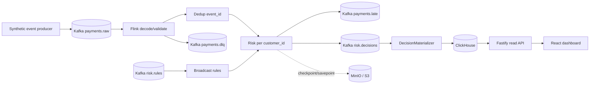

# Payment Risk — Production technical plan

**Status:** original plan and review of changes merged into `main`  
**Last updated:** 12 October 2026  
**Repository:** [acilione/payment-risk](https://github.com/acilione/payment-risk)  
**Baseline for the 9 October proposal:** branch `main`, commit [`9dfd9d6a063394039eed5951d5d0060a3bc92eee`](https://github.com/acilione/payment-risk/tree/9dfd9d6a063394039eed5951d5d0060a3bc92eee)  
**Audience:** Backend/Data Engineering, Platform/SRE, Security, Fraud/Risk, Data Governance  
**Assumed scope:** asynchronous fraud monitoring and risk assessment, rather than synchronous decisions in the authorization path.

> **Review approach.** This document distinguishes **AS-IS** behavior observable in source code and CI, **TO-BE** proposals, and **assumptions to validate**. Passing CI does not establish production readiness. Example timelines, effort estimates and SLOs need to be assessed against actual business requirements; they are not demonstrated capabilities.

---

> Sections 1–11 preserve the proposal from 9 October. Their diagrams, gaps and AS-IS descriptions refer to the original baseline, not the current code. Sections 12–14 record subsequent reviews and implementation work. The domain remains simulated, as agreed.

## Current status

The changes from `feat/production-plan` were merged into `main` in commit [`73191ce`](https://github.com/acilione/payment-risk/commit/73191ce1d635db6ad4ce243845c1c3ed87c5ca9a). The [README](../README.md) is the current technical reference. This document records the reasoning and proposals, including those that were not adopted.

- **Pipeline and persistence:** event and transaction identity checks, an independent input archive, persisted assessments and invalid/late records, reconciliation of acknowledged inputs, and an explicit replay policy. Conflicts are not resolved by arbitrarily choosing a result. Flink deduplication remains limited by its TTL.
- **State and load:** individually stored pending payments, incremental features for dense histories, expiry indexes, and database batches bounded by bytes, rows and age. Tests compare complete evidence with the reference algorithm and verify restoration of previous state formats.
- **Demonstration:** a configurable, reproducible generator feeding the entire pipeline, an investigation dashboard with pagination, and a static demo exported from a verified run of the simulated domain. The nine stories in section 13 remain an integration fixture separate from the configurable generator.
- **Measurements:** [state comparison](evidence/state-load-comparison-2026-10-12.json), [database outage and recovery load test](evidence/pipeline-load-recovery-2026-10-12.json), and [analytical query limits](../README.md#analytical-query-load). These are local or CI experiments, not evidence of capacity for bank-scale traffic.
- **Remaining work:** a permanent transactional identity registry, dashboard aggregates that remain correct after replay, replicated storage, and recovery tests for an actual deployment. An identity provider, production contracts and fraud evaluation against real outcomes require integrations and data that are not available.

Configuration, the data model, operating procedures and current limits are documented in the README rather than duplicated here.

## 1. Executive summary

Payment Risk is a Java/Apache Flink pipeline that consumes Avro payment events from Kafka, maintains customer state, applies five versioned risk rules, and publishes `APPROVE`, `REVIEW` and `REJECT` decisions. A dedicated consumer materializes decisions in ClickHouse. Fastify and React provide analytical dashboards, while Prometheus and Grafana provide observability. RocksDB and checkpoints in S3/MinIO support state recovery.

The project provides a technical foundation for asynchronous fraud monitoring, with tests for event time, deduplication, snapshot/restore and recovery. At the stated baseline, the GitHub Actions `verify` and `website` workflows passed, including integration tests and demo deployment. Readiness for real traffic on a production cluster and the statistical effectiveness of the fraud rules have not been established.

### Recommended decisions

1. **Keep Kafka, Flink and the event-driven design.** An asynchronous use case does not require an architectural rewrite.
2. **Define the domain model first.** Separate events, payment attempts, risk evaluations and the current-decision projection.
3. **Specify operational semantics.** Define pending/late policies, replay and deduplication, deterministic policy application, and end-to-end reconciliation.
4. **Make the environment secure and operable.** Address IAM/RBAC, data access, DLQ payload minimization, resilient infrastructure and disaster recovery procedures.
5. **Validate behavior and value.** Use realistic benchmarks, SLOs, labeled fraud outcomes, shadow mode, and false-positive/negative measurements before automating actions.

### Readiness by objective

| Objective | Assessment | Reason |
|---|---|---|
| Portfolio / technical demo | **Ready** | Architecture, documentation, code and integrated CI can be demonstrated. |
| Proof of concept with synthetic traffic | **Ready with stated limits** | `verify` and `website` passed on `main`. |
| Controlled, non-blocking pilot with business data | **Conditional** | Domain contracts, security, operations and reconciliation are required. |
| Production asynchronous monitoring | **Not yet qualified** | Measured SLOs, data controls, end-to-end HA and realistic load tests are missing. |
| Synchronous pre-authorization / payment blocking | **Outside current scope** | Requires a synchronous decision API, current online features, a latency budget and fail-open/fail-closed policies. |

---

## 2. AS-IS technical baseline

### 2.1 Components and responsibilities



| Area | AS-IS | Concern |
|---|---|---|
| Ingestion | Kafka + Avro, Apicurio schemas, validation | Payment lifecycle semantics are incomplete. |
| Processing | Flink with `keyBy(event_id)`, then `keyBy(customer_id)` | Hot keys and increasing cost of reconstructing history. |
| Configuration | Broadcast rule state with monotonically increasing versions | Activation is not deterministic during replay across two independent streams. |
| Delivery | Kafka `EXACTLY_ONCE` sinks; `read_committed` consumers | The materializer and ClickHouse are outside the Flink/Kafka transaction. |
| Analytics | ClickHouse `ReplacingMergeTree(source_offset)` per `transaction_id` | Technical retries and business reevaluations share the same projection. |
| UI/API | Read-only Fastify + React | Authentication and authorization are missing for access to real business events. |
| Infrastructure | Local Compose; Flink Kubernetes chart; S3 Terraform | The repository does not provide a complete HA deployment of all services. |
| Observability | Prometheus, Grafana, checkpoint/lag/backpressure alerts | End-to-end SLOs, reconciliation and operational runbooks need completion. |

### 2.2 Test status at the baseline

- [`verify` workflow](https://github.com/acilione/payment-risk/actions/runs/37805656758): **passed** (Java, integration/recovery, scans, Terraform).
- [`website` workflow](https://github.com/acilione/payment-risk/actions/runs/37805656731): **passed** (API/browser/build, container scan, deployment).
- The local configuration is reproducible through Compose. This does not establish that a multi-node topology has been tested under production conditions.
- Benchmark **reported in the README**, not repeated in this review: 1,000 events, approximately 100 producer-acknowledged events/second, event-to-Kafka-visibility p95 of approximately 20.793 seconds, on a shared WSL2 environment. This is not a sustained-capacity measurement or an SLO guarantee.

**Primary sources:** [`PaymentRiskJob.java`](https://github.com/acilione/payment-risk/blob/9dfd9d6a063394039eed5951d5d0060a3bc92eee/src/main/java/com/portfolio/paymentrisk/PaymentRiskJob.java), [`CustomerRiskProcessor.java`](https://github.com/acilione/payment-risk/blob/9dfd9d6a063394039eed5951d5d0060a3bc92eee/src/main/java/com/portfolio/paymentrisk/processor/CustomerRiskProcessor.java), [`README.md`](https://github.com/acilione/payment-risk/blob/9dfd9d6a063394039eed5951d5d0060a3bc92eee/README.md).

---

## 3. Data model: baseline and concerns

### 3.1 Baseline contracts

| Stream/topic | Schema | Identity / key | Purpose |
|---|---|---|---|
| `payments.raw` | `Transaction` | `event_id` in the payload; producer Kafka key `customer_id` | Incoming payment facts. |
| `risk.rules` | `RiskRule` | `rule_id` | Updates to the five rules. |
| `risk.decisions` | `RiskDecision` | Kafka key `customer_id`; `decision_id = risk_ + transaction_id` | Risk assessments. |
| `payments.dlq` | `DeadLetter` | `error_id = topic:partition:offset` | Validation/deserialization errors. |
| `payments.late` | `LateEvent` | Kafka key `customer_id` | Events rejected after the finalization frontier. |

- **`Transaction`:** `event_id`, `transaction_id`, `customer_id`, `merchant_id`, `device_id`, `amount_minor`, `currency`, `country`, `status` (`APPROVED`/`DECLINED`), `event_time`, `producer_time`. EUR only; amounts in minor units.
- **`RiskRule`:** `rule_id`, `version`, `type`, `enabled`, `score`, `window_seconds`, `threshold`, `currency`, `updated_at`.
- **`RiskDecision`:** identifiers, amount, score, classification, matched rules, reason codes, `rules_fingerprint`, `event_time`, `processed_at`.
- **Flink state:** `pending` (event + rule snapshot), `history` (customer features: 1 hour), `devices` (last observation: 30 days), `finalizedThrough`, and `event_id` deduplication with a 24-hour processing-time TTL.
- **ClickHouse:** `risk.decisions` with `ReplacingMergeTree(source_offset) ORDER BY transaction_id`, exposed through `risk.decisions_current` using `FINAL`.

### 3.2 Issues to resolve before using real data

**MD-01 — Implicit lifecycle.** `status` contains an outcome (`APPROVED`/`DECLINED`) but does not distinguish authorization, attempt, capture, refund, reversal or chargeback. Multiple events for one `transaction_id` may be legitimate and must not be confused with duplicates.

**MD-02 — Insufficient evaluation identity.** `decision_id` derives from `transaction_id` and does not distinguish reevaluations. The ClickHouse projection keeps one logical row per transaction and therefore is not a complete audit trail.

**MD-03 — Version semantics tied to Kafka.** `source_offset` is monotonic only within a partition; it is not a global business revision. Changing partitioning or the relationship between customer and transaction can produce incorrect version ordering.

**MD-04 — Partial explanations.** Decisions retain `matched_rules` and a fingerprint, but not observed feature values, evaluated thresholds or the immutable rule definition associated with the result.

**MD-05 — Missing outcomes.** No confirmed fraud, chargeback or human-review outcomes are linked to decisions. The project therefore cannot measure precision, recall, false positives or investigation costs.

**MD-06 — Retention serves different purposes.** The deduplication TTL (24 hours), history retention (1 hour and 30 days) and local Kafka retention (7 days) are independent. Replay, corrections, audit retention, deletion and privacy need explicit contracts.

---

## 4. Proposed target model

### 4.1 Proposed logical entities

| Entity | Proposed key | Responsibility | Suggested storage |
|---|---|---|---|
| `PaymentEvent` | `event_id` | Immutable event with type, cause and timestamp | Kafka + controlled append-only archive |
| `PaymentAttempt` | `attempt_id` | Authorization attempt linked to the transaction | Upstream model or dedicated projection |
| `RiskEvaluation` | `evaluation_id` | One immutable evaluation, including repeated or corrected evaluations | Kafka + append-only ClickHouse |
| `CurrentRiskDecision` | `(transaction_id, attempt_id)` or an agreed business key | Latest evaluation under an explicit ordering | Query-oriented projection |
| `RiskPolicyVersion` | `(policy_id, version)` | Approved configuration, activation, author and checksum | Durable, versioned configuration store |
| `RuleEvidence` | `(evaluation_id, rule_id)` | Feature, threshold, result and score contribution | Nested in RiskEvaluation or a separate table |
| `RiskOutcome` | `outcome_id` | Confirmed fraud, chargeback, review or false alarm | Dedicated streams/tables |
| `ReplayAction` | `replay_id` | Replay audit: reason, source, window and result | Metadata store / audit log |

> These are **logical** entities. They do not require a separate microservice or database for each one. Validate the fields with upstream payment systems and Fraud/Risk.

### 4.2 Conceptual `PaymentEvent` v2 schema

```json
{
  "event_id": "evt_01...",
  "transaction_id": "txn_01...",
  "attempt_id": "att_01...",
  "customer_id": "cust_...",
  "merchant_id": "mer_...",
  "event_type": "AUTHORIZATION_DECLINED",
  "amount_minor": 90000,
  "currency": "EUR",
  "device_id": "dev_...",
  "event_time": 1791500000000,
  "producer_time": 1791500000350,
  "source_system": "payments-api",
  "correlation_id": "trace_...",
  "schema_version": 2
}
```

**Proposed constraints:** globally unique, immutable `event_id`; required `attempt_id` where an attempt exists; `event_type` from a shared vocabulary; `correlation_id` for tracing; `event_time` as the time of the business fact and `producer_time` as emission time. Keep payment status separate from the risk decision. Define which event types trigger an evaluation, and prevent non-monetary updates from incorrectly increasing counts or amounts.

### 4.3 Conceptual `RiskEvaluation` v2 schema

```json
{
  "evaluation_id": "eval_01...",
  "event_id": "evt_01...",
  "transaction_id": "txn_01...",
  "attempt_id": "att_01...",
  "customer_id": "cust_...",
  "policy_id": "payment-risk-eu",
  "policy_version": 3,
  "policy_fingerprint": "sha256:...",
  "risk_score": 65,
  "risk_band": "REVIEW",
  "evaluation_mode": "FINAL",
  "rule_evidence": [
    {
      "rule_id": "R002",
      "rule_version": 3,
      "feature": "amount_10m_minor",
      "observed": 345000,
      "threshold": 300000,
      "matched": true,
      "score_contribution": 35
    }
  ],
  "evaluated_at": 1791500001800,
  "engine_version": "payment-risk/0.x"
}
```

**Note:** these are conceptual contracts, not valid or implemented Avro files. The final schemas need Avro types, nullability/defaults, stable reason codes, a compatibility policy and data minimization. `evaluation_mode` is useful only if provisional/final decisions are adopted; do not add it without defining its lifecycle.

### 4.4 Recommended persistence

1. **Append-only `risk_evaluations`:** retain all legitimate evaluations. Keep provenance (`topic`, `partition`, `offset`, `ingested_at`) separate from business versioning.
2. **`risk_current` query model:** use `argMax`/aggregations or an updated projection according to an explicit business key and revision, rather than a Kafka offset alone. Define what is current when corrections, attempts and retries coexist.
3. **Ingestion idempotency:** recognize repeated deliveries through stable event/evaluation keys. Reconciliation must distinguish physical rows from logical records. Select and test ClickHouse deduplication according to workload: insert deduplication tokens/table semantics, a keyed view, or controlled upserts. No technique alone establishes end-to-end exactly-once behavior without evidence.
4. **Retention by purpose:** raw events, risk audit, PII metadata, outcomes, checkpoints and analytics have different retention periods and access requirements.

### 4.5 Compatible evolution instead of breaking changes in place

The repository policy requires tests against historical writer schemas and versioned topics for incompatible changes. Recommendations:

- Keep `payments.raw`, `risk.decisions` and their v1 consumers during transition.
- Introduce v2 topics (`payments.raw.v2`, `risk.evaluations.v2`) and registered contracts with explicit compatibility policies.
- Use dual publishing or an adapter in staging. Evaluate production dual writes against their inconsistency risks.
- Run v1 and v2 in shadow mode, comparing counts and classifications using `event_id`, `attempt_id` and `evaluation_id`.
- Migrate the dashboard and readers only after reconciliation, then retire v1 within an agreed window.
- For stateful Flink, test savepoint restoration and serializer/UID compatibility. Do not rename descriptors or change state JSON semantics without a migration strategy.

---

## 5. Technical backlog: impact, risk and acceptance criteria

### Legend

- **P0:** required before a non-blocking pilot with real data, or a blocking architectural decision.
- **P1:** required to qualify a reliable production service.
- **P2:** later optimization or extension, subject to measurements.
- **Effort:** S / M / L / XL are relative sizes, not person-days.
- **Impact:** data (schema/retention), correctness, latency, operations and security.

| ID | Priority | Improvement | Main benefit | Change risk/cost | Effort |
|---|---|---|---|---|---|
| PR-01 | P0 | `PaymentEvent`/`PaymentAttempt` v2 contracts | Domain correctness, upstream integration | Breaking schemas and producer changes | L |
| PR-02 | P0 | Immutable evaluations + current projection | Audit, replay, history, idempotency | ClickHouse and query migration | L |
| PR-03 | P0 | Pending/late event semantics | Completeness and predictable decision times | Event-time accuracy versus timeliness | L |
| PR-04 | P0 | Versioned, approved, reproducible policies | Explainability and determinism | Rule schemas/order, state migration | L |
| PR-05 | P0 | Authentication/authorization, data access and PII/DLQ | Data protection and role separation | Identity and governance dependencies | L |
| PR-06 | P0 | Reconciliation + controlled replay | Detect and recover missing records | Duplicate emissions, backfill errors | M/L |
| PR-07 | P1 | Materializer/ClickHouse reliability | Stability during outages and retries | Versioning semantics and throughput | M/L |
| PR-08 | P1 | End-to-end HA deployment, backup/DR | Availability and recovery | Infrastructure cost, cluster operations | XL |
| PR-09 | P1 | SLOs, end-to-end metrics and runbooks | Operability and incident response | Instrumentation and false alerts | M |
| PR-10 | P1 | Load tests, hot keys and state profiling | Capacity planning and predictable costs | Performance regressions, tuning | M/L |
| PR-11 | P1 | Outcomes / rule effectiveness evaluation | Measurable fraud detection quality | Label quality, delayed outcomes | L |
| PR-12 | P2 | Incremental features and state optimization | Lower CPU use and latency under heavy load | Counter complexity and migrations | L/XL |
| PR-13 | P2 | Dashboard/API modularization | Maintainability and testability | Refactoring, UI regressions | M |
| PR-14 | Conditional | Synchronous pre-authorization decisions | Act on risk before authorization | Different SLAs and failure modes; a substantial change | XL |

### PR-01 — Distinguish events, attempts and transactions

**Changes:** add `attempt_id` and `event_type`; define their vocabulary, uniqueness and immutability; distinguish events that feed features from informational events and corrections. Involve the payment lifecycle owners.

**Impact:** improves deduplication and velocity calculations, avoiding repeated counting of the same economic operation. Requires new contracts and changes to producers, the engine and tests. **Acceptance:** documented approval/decline/retry/reversal/refund fixtures; each event has one defined treatment, with expected counts and amounts reconciled.

### PR-02 — Separate evaluation history from the current projection

**Changes:** stable `evaluation_id`, an append-only evaluation stream and analytical archive, and a current projection with an explicit business key/version. Migrate APIs to the projection while retaining a detailed audit query.

**Impact:** prevents logical loss of legitimate evaluations and makes replay inspectable. Increases stored volume and requires SQL migration, retention and query changes. **Acceptance:** two legitimate events for one transaction produce two traceable evaluations; a technical retry does not increase the logical evaluation count; the current projection chooses the version specified by the contract.

### PR-03 — Define a contract for pending events, watermarks and lateness

**Baseline problem:** queued events may remain unprocessed when every partition is idle. Events that arrive too late neither produce a new decision nor update history.

**Options to evaluate:**

1. **Conservative:** finalize only in event time using watermarks. Expose the pending backlog and maximum observed waiting times, and require stream advancement to drain the queue.
2. **Processing-time deadline:** emit an explicitly `PROVISIONAL` result at a deadline, followed by a possible `FINAL` result or an agreed correction policy. Downstream consumers must distinguish the states.
3. **Controlled watermark/heartbeat source:** manage progress per partition, with validated semantics that prevent premature finalization of still-valid events.

**Recommendation:** agree on a measurable freshness requirement and late/correction contract with Fraud/Risk before adding timers. **Acceptance:** tests cover idle queues, restarts, out-of-order arrivals and long pauses; no admitted event remains pending indefinitely without the status or alert required by the policy.

### PR-04 — Versioned, deterministic policies

**Changes:** retain `policy_id`, version, complete signed/approved configuration, activation timestamp and author audit. Determine the applicable policy through reproducible rules rather than incidental interleaving of `risk.rules`. Include `policy_version`/`engine_version` and rule evidence in the output.

**Impact:** improves replay and audit consistency. Requires a choice between event-time `effective_at` semantics and processing-time application, update planning and state migration. **Acceptance:** replaying the same dataset with the same versioned policy catalog produces the same result for each `event_id`, except for explicitly versioned corrections.

### PR-05 — Access, privacy and application security

**Changes:** protect Fastify through an identity provider/OIDC or a verified gateway; use RBAC for the dashboard and rules, separate ClickHouse read/write accounts, managed and rotated credentials, least-privilege Kafka ACLs, Kubernetes/network restrictions, and encryption at rest appropriate to the risk. Classify identifiers and payloads and define retention.

**DLQ note:** the baseline `raw_payload` contains Base64 for up to 4,096 event bytes. Base64 is not encryption. For real data, prefer a redacted payload or a reference with controlled access and a TTL, according to diagnostic and replay requirements.

**Impact:** improves data protection and access control; introduces IAM integrations, policies and penetration testing. **Acceptance:** unauthorized users cannot access APIs or sensitive metrics; service privileges are minimal; access is audited; privacy review and applicable controls, including GDPR and PCI DSS where relevant to the data scope, are documented.

### PR-06 — Reconciliation, DLQ/late remediation and replay

**Changes:** stable-key accounting and a reconciliation dashboard covering valid inputs, suppressed duplicates, late records, DLQ records and finalized evaluations. Add a versioned selective replay command or job with `replay_id`, dry run, time ranges, rate limits and audit.

**Impact:** enables detection and recovery of gaps; replay can create duplicates if it does not preserve event identity. **Acceptance:** failover and reinsertion of the same messages leave the expected evaluation count unchanged; every gap has an explanation or an operational ticket; replay is repeatable and interruptible.

### PR-07 — Reliable materializer and analytical archive

**Changes:** retries with exponential backoff and jitter; handling of undecodable records without indefinitely blocking a whole partition; consumer lag and insert latency metrics; tested idempotency; separate read/write identities; versioning of the current model. Evaluate adaptive batching, parallelism and database partitioning from measured results.

**Impact:** reduces interruptions and improves visibility, with new error cases and migrations to handle. **Acceptance:** stopping ClickHouse and restarting the materializer causes neither logical loss nor an increase in unique `RiskEvaluation` records; delays are visible and trigger alerts; queries return the same results before and after replay.

### PR-08 — HA deployment and disaster recovery

**Changes:** staging with replicated/managed Kafka, a reliable registry and metadata store, the Flink Operator with checkpoints/savepoints in object storage, ClickHouse with verified backups and availability suitable for the workload, isolated and scheduled materializer/API services, secrets, network policies, storage lifecycle, capacity limits, and defined upgrades/rollback. Prefer managed object storage for production; the local MinIO build is not a recommendation for operating production MinIO.

**Impact:** reduces single points of failure while increasing cost and operational complexity. **Acceptance:** documented worker-loss, cluster-restart, S3-recovery, database-restore, application-rollback and backfill tests; RTO/RPO measured against agreed targets.

### PR-09 — SLOs, KPIs and runbooks

**Changes:** define indicators for event-to-evaluation, event-to-Kafka-visibility, event-to-ClickHouse-visibility, pending age, customer state size, DLQ/late ratios, policy freshness, Kafka lag, checkpoint duration/failures, consumer error rate and reconciliation gaps. Update dashboards and alerts with owners and playbooks.

**Impact:** makes the service operable with relatively limited effort. **Acceptance:** service and domain dashboards are available; alert thresholds reflect measured baselines and have real recipients; an incident exercise is documented. **Non-binding initial SLO example:** classify 99.9% of valid events within 60 seconds under a specific traffic profile. Adopt it only after benchmarking and confirming the business requirement.

### PR-10 — Realistic performance tests

**Changes:** a concurrent load generator; acknowledged and achieved throughput metrics; steady, hot-key, high-cardinality, out-of-order, late and spike scenarios; checkpoint profiling; CPU/memory, p50/p95/p99 latency and cost measurements. Separate `RiskEngine.evaluate` measurements from end-to-end latency, which includes watermarks, checkpoints, Kafka, the materializer and ClickHouse.

**Impact:** supports justified scaling decisions and can reveal bottlenecks. **Acceptance:** reproducible, versioned reports with commit, configuration, data sizes and results; sustained tests without unbounded lag/state growth; documented saturation and degradation.

### PR-11 — Fraud outcomes and rule effectiveness

**Changes:** collect labels linked to `transaction_id`/`attempt_id`/`evaluation_id` with availability timestamps; handle delayed and corrected outcomes; introduce cohorts and segmentation, precision/recall, false-positive rate, alert rate, review cost, leakage and drift measurements. Use shadow mode before automating payment actions.

**Impact:** makes product effectiveness measurable, subject to outcome quality and governance. **Acceptance:** comparison with a baseline and results by segment; approved false-positive thresholds; a repeatable policy validation/versioning process.

### PR-12 — Incremental features after profiling

**Changes:** avoid repeatedly scanning the complete customer history for each event. Maintain rolling counts/sums and device sets/cardinalities with windows and TTLs, potentially using time buckets with validated granularity. Evaluate JSON state representation and hot-key skew.

**Impact:** reduces CPU use, latency and cost for dense workloads, while increasing complexity and the risk of window-boundary regressions. **Acceptance:** exact score equivalence against fixtures/an oracle, including boundaries, restore, late events and equal timestamps; measurable improvement for hot keys without reducing correctness.

### PR-13 — Frontend/API refactoring

**Changes:** split `web/src/main.tsx`, approximately 1,300 lines at the baseline, into features and components; improve API response types; add pagination/server-side filtering beyond the latest 100 loaded records; add browser/API tests for authorization and audit.

**Impact:** improves maintenance and usability but is not a prerequisite for a technically correct monitoring pipeline. **Acceptance:** unchanged UI behavior, passing tests, and paginated queries within agreed cost limits.

### PR-14 — Synchronous decisions, only if required

**Changes:** a pre-authorization service with a request/response API, idempotency keys, current online features, strict timeouts, and business-approved `fail-open`, `fail-closed` or `step-up` policies. Flink remains the feature-update and analytics pipeline.

**Impact:** changes the product, operational risk and latency architecture; reducing checkpoint intervals is insufficient. **Acceptance:** defined latency budgets and SLAs, fallback tests, failure injection, traceability and control of automated decisions.

---

## 6. Cross-cutting impact matrix

| Change | Schemas/events | Flink state | Kafka | ClickHouse/API | Operations and risk |
|---|---|---|---|---|---|
| PaymentEvent v2 | **High:** breaking contract | Medium: features and deduplication | New topics/producers | Medium: new mapping | Upstream/downstream mismatch risk |
| Append-only RiskEvaluation | **High:** new output | Low/medium | New evaluation topic | **High:** new tables/queries | Data migration + storage growth |
| Deterministic policies | Medium/high | **High:** broadcast and restore | Topic/store versioning | Medium: audit metadata | Changes scoring timing and results |
| Deadlines/late policy | Medium: possible new states | **High:** timers/watermarks | Possible corrective outputs | Medium/high: projection | Accuracy versus timeliness |
| Idempotent materializer | Low/medium | None | Consumer semantics | **High:** identity/versioning | Reduces duplicates; requires reconciliation |
| Security + RBAC | Low | Low | ACLs/credentials | **High** for the API | Requires an identity provider and secret management |
| HA + disaster recovery | None | Restore/upgrade | Replicated cluster | Backup/HA | Higher cost, less downtime |
| Incremental features | None or minimal | **High:** state migration | None | None | Score regression risk |
| Outcomes and validation | New outcome contract | Possible future join | New events | New metrics/tables | Requires label quality and availability |

**Compatibility risk:** the greatest risks concern key semantics, serialized Flink state and decision application order. These require migration tests with anonymized real data or representative synthetic data.

---

## 7. Implementation and migration plan

### Phase 0 — Decisions and contracts before code

**Deliverable:** an approved RFC defining asynchronous operation, transaction/attempt semantics, late-event policy, evaluation identity and versioning, retention and audit, and SLOs to measure.

**Gate:** Fraud/Risk, the payment platform, Security and Data Platform agree on lifecycle examples and failure conditions. No breaking change starts before this agreement.

### Phase 1 — Domain correctness and audit (PR-01, PR-02, PR-04)

1. Create v2 Avro schemas and contract-test fixtures.
2. Introduce event types and payment-attempt identification.
3. Produce evaluations with their own IDs, policy versions and rule evidence.
4. Add append-only storage and a current projection with defined semantics.
5. Build a v1/v2 comparison tool for synthetic events and staging datasets.

**Gate:** output differences can be explained; no legitimate evaluations are lost; technical replay is logically idempotent; upstream compatibility is validated.

### Phase 2 — Time semantics, recovery and problematic data (PR-03, PR-06, PR-07)

1. Apply and test the pending/late/timeout policy.
2. Implement reconciliation for every output category.
3. Add materializer retries and diagnostics.
4. Implement controlled, selective replay with audit.
5. Cover Kafka/ClickHouse fault injection and Flink restore.

**Gate:** every input is classified or recorded through an exception path under a measurable policy; repeated replay does not alter logical counts.

### Phase 3 — Realistic staging and security (PR-05, PR-08, PR-09)

1. Deploy the whole system on non-local infrastructure.
2. Enable authentication/authorization, component identities, network controls and PII policies.
3. Exercise backup restoration, rollback and incident response.
4. Publish SLO dashboards, ownership and runbooks.

**Gate:** security review passed, RTO/RPO demonstrated, auditable data access, and alerts with an escalation path.

### Phase 4 — Performance and business value (PR-10, PR-11, PR-12)

1. Benchmark realistic load and state, including hot-key profiling.
2. Optimize state only where measurements justify it.
3. Ingest labeled outcomes and evaluate rules by segment.
4. Run in shadow mode on real events before enabling alerts and automated actions.

**Gate:** SLOs met under the target traffic profile; documented rule effectiveness; false positives acceptable to Fraud/Risk; immediate rollback available.

### Recommended rollback strategy

- Keep v1 and v2 running in parallel until reconciliation is complete.
- Deploy new consumers against new topics. Avoid simultaneously changing producers, schemas, the state backend and the dashboard.
- Retain savepoints/checkpoints compatible with the version being restored and test the restore itself.
- If decisions diverge, switch downstream readers back to the v1 projection and retain v2 output for analysis without overwriting it.
- Do not rely on a simple `git revert` when Kafka schemas, tables or Flink serializers have changed.

---

## 8. Test plan and release criteria

| Category | Minimum scenarios | Expected gate |
|---|---|---|
| Contract/schema | v1→v2 evolution, unknown types/events, defaults/nulls | Avro and consumer compatibility tests in CI |
| Domain | Authorization decline, retry, approval, reversal, refund, repeated event | Defined counting semantics for each fixture |
| Event time | In order, out of order, equal timestamps, idle, very late | Consistent decisions; deadline/late policy respected |
| Policy | Activate/update/disable, restart, replay, version collision | Reproducible rules with the same configuration |
| Delivery | Crash before/after Kafka commit; successful ClickHouse insert without offset commit | No logical loss; duplicates detected/handled |
| Replay | Same `event_id`, same data across multiple batches, replay after TTL | Explicit behavior consistent with the contract |
| Security | Anonymous user, unauthorized tenant/role, secret rotation | Access denied and audit recorded |
| HA/DR | TaskManager kill, Kafka broker outage, ClickHouse outage, S3 restore | RTO/RPO and reconciliation within targets |
| Load | Steady, burst, hot-key, high-cardinality, runs beyond the retention period under test | No uncontrolled lag; known resource profile |
| Observability | Metrics endpoint down, stalled checkpoint, DLQ surge, stale policy | Verified alerts and executable runbooks |
| Fraud effectiveness | Mature outcomes, label delays, segments and thresholds | Precision/recall and costs compared with a baseline |

### Definition of done for each change

Every production ticket must include contract changes and versions, positive/negative and regression tests, migration/rollback plans, benchmarks if state or latency is affected, new metrics, security/privacy impact, operational documentation, activation criteria and a service owner.

### Go-live criteria for a real, non-blocking pilot

- [ ] Approved definitions for the event lifecycle and identities.
- [ ] Immutable risk evaluations and a queryable audit trail.
- [ ] Reproducible policy timing and associated audit.
- [ ] Documented handling of pending events, late records, DLQ records and replay.
- [ ] Authenticated access and separate permissions for real data.
- [ ] End-to-end reconciliation with visible discrepancies and exceptions.
- [ ] HA, backup and restore tested in staging similar to production.
- [ ] SLOs measured against the target load profile.
- [ ] Security testing and privacy review completed.
- [ ] Rules initially run in shadow mode without blocking real authorizations.

---

## 9. Open decisions requiring ADRs

| ADR | Question | Effect of the answer |
|---|---|---|
| ADR-001 | Asynchronous risk monitoring or pre-authorization decisions? | Defines latency budget, APIs and failure modes. |
| ADR-002 | What do `transaction_id`, `attempt_id` and `event_id` mean? | Keys, deduplication, counts, audit and reprocessing. |
| ADR-003 | Which events feed each rule? | Correct counts and cumulative amounts. |
| ADR-004 | What deadline applies to a pending event, and what happens afterward? | Watermarks, late corrections, SLAs and projections. |
| ADR-005 | Is policy activation based on event time or processing time? | Replay determinism and audit. |
| ADR-006 | What identifies an evaluation, and what is the current decision? | Kafka schemas and analytical storage. |
| ADR-007 | How long are raw data, audit, PII, DLQ and checkpoints retained? | Cost, GDPR/privacy and replay availability. |
| ADR-008 | Who can view data, change policies and run replay? | IAM, RBAC, secrets and separation of responsibilities. |
| ADR-009 | Which RTO/RPO, throughput and SLO targets have business value? | Topology, cost and qualification tests. |
| ADR-010 | When is a rule effective enough to trigger an action? | Fraud metrics, approvals and rollout. |

---

## 10. Practical priorities for a small team

Avoid starting with new microservices, external feature stores or machine learning. The recommended sequence is:

1. **Domain/keys and immutable evaluations** (`PR-01`, `PR-02`): enable audit and reprocessing without ambiguous data.
2. **Policies and timing** (`PR-03`, `PR-04`): prevent correctness surprises during restore/replay.
3. **Access and reconciliation** (`PR-05`, `PR-06`): establish prerequisites for sensitive data and operations.
4. **Reliability and HA staging** (`PR-07`, `PR-08`, `PR-09`): make the service operable beyond the demo.
5. **Measurements and fraud detection quality** (`PR-10`, `PR-11`): demonstrate value and guide optimization (`PR-12`).

Before concrete measurements, do not prioritize a complete microservice redesign, machine learning, a frontend rewrite, a separate database for every entity or sophisticated RocksDB tuning without a load profile.

### Expected overall impact

| Dimension | Original baseline | After phases 1–4: target, not guarantee |
|---|---|---|
| Correctness | Rules tested against the current synthetic contract | Formal attempt semantics and reproducible results |
| Audit | Current decision + fingerprint | Immutable history and comparable rule evidence |
| Idempotency | Kafka exactly-once + ClickHouse projection with partitioning assumptions | Reconciliation and application keys with explicit semantics |
| Latency | Limited measurements; pending events may wait for watermarks | SLOs for a defined profile and a documented finalization policy |
| Availability | Compose recovery verified in CI | HA, backup and rollback tested in target staging |
| Security | Basic controls and local-only deployment | Identity, least privilege, retention and audit suitable for real data |
| Fraud detection value | Rule scores without ground truth | Effectiveness measured against outcomes and validated in shadow mode |

---

## 11. Repository references

- [README and architecture](https://github.com/acilione/payment-risk/blob/9dfd9d6a063394039eed5951d5d0060a3bc92eee/README.md)
- [Flink pipeline](https://github.com/acilione/payment-risk/blob/9dfd9d6a063394039eed5951d5d0060a3bc92eee/src/main/java/com/portfolio/paymentrisk/PaymentRiskJob.java)
- [Risk engine](https://github.com/acilione/payment-risk/blob/9dfd9d6a063394039eed5951d5d0060a3bc92eee/src/main/java/com/portfolio/paymentrisk/domain/RiskEngine.java)
- [Customer state management](https://github.com/acilione/payment-risk/blob/9dfd9d6a063394039eed5951d5d0060a3bc92eee/src/main/java/com/portfolio/paymentrisk/processor/CustomerRiskProcessor.java)
- [Deduplication](https://github.com/acilione/payment-risk/blob/9dfd9d6a063394039eed5951d5d0060a3bc92eee/src/main/java/com/portfolio/paymentrisk/processor/Deduplicate.java)
- [Transaction schema](https://github.com/acilione/payment-risk/blob/9dfd9d6a063394039eed5951d5d0060a3bc92eee/schemas/transaction.avsc)
- [RiskRule schema](https://github.com/acilione/payment-risk/blob/9dfd9d6a063394039eed5951d5d0060a3bc92eee/schemas/risk-rule.avsc)
- [RiskDecision schema](https://github.com/acilione/payment-risk/blob/9dfd9d6a063394039eed5951d5d0060a3bc92eee/schemas/risk-decision.avsc)
- [Schema compatibility policy](https://github.com/acilione/payment-risk/blob/9dfd9d6a063394039eed5951d5d0060a3bc92eee/schemas/compatibility-policy.yaml)
- [ClickHouse DDL](https://github.com/acilione/payment-risk/blob/9dfd9d6a063394039eed5951d5d0060a3bc92eee/infrastructure/docker/clickhouse.sql)
- [DecisionMaterializer](https://github.com/acilione/payment-risk/blob/9dfd9d6a063394039eed5951d5d0060a3bc92eee/src/main/java/com/portfolio/paymentrisk/tools/DecisionMaterializer.java)
- [API overview](https://github.com/acilione/payment-risk/blob/9dfd9d6a063394039eed5951d5d0060a3bc92eee/web/server/overview.mjs)
- [Docker Compose](https://github.com/acilione/payment-risk/blob/9dfd9d6a063394039eed5951d5d0060a3bc92eee/docker-compose.yml)
- [Helm deployment](https://github.com/acilione/payment-risk/blob/9dfd9d6a063394039eed5951d5d0060a3bc92eee/infrastructure/helm/payment-risk/templates/deployment.yaml)
- [Prometheus alerts](https://github.com/acilione/payment-risk/blob/9dfd9d6a063394039eed5951d5d0060a3bc92eee/observability/prometheus/alerts.yml)
- [Successful verify workflow](https://github.com/acilione/payment-risk/actions/runs/37805656758)
- [Successful website workflow](https://github.com/acilione/payment-risk/actions/runs/37805656731)

---

The main investment is to define the domain, preserve the audit trail, make policies deterministic and measure operations. These changes support an asynchronous fraud-monitoring service while retaining the streaming architecture. Use in the authorization path remains a separate project with substantially stricter latency and availability requirements.

## 12. Second review and branch implementation

### 12.1 Overall assessment

Resilience is not optional. A financial analysis system that counts a transaction twice or loses an assessment can produce incorrect alerts, statistics and investigations even when it does not authorize payments. However, calling it highly resilient is not a testable specification. Result correctness, data loss, availability and publication delay need separate requirements.

For the current domain, correctness takes priority. Contradictory identities stop the affected processing or publication of totals. During a storage outage, offsets remain uncommitted and publication delay increases. This does not approve or decline a real payment. The pipeline is asynchronous, and its APPROVE/REVIEW/REJECT labels do not represent bank authorization.

The plan identifies real problems. Identity, result retention, conflicts, rule configuration, commit boundaries and reconciliation are the most urgent corrections. Adding attempts, capture, refunds, tenants, corporate identities or an imagined cloud platform immediately is not justified: real contracts, an identity provider and staging are unavailable. The branch work respects that constraint.

### 12.2 Four different meanings of duplicate

| Case | Implemented response | Limit |
|---|---|---|
| Same `event_id`, same data, new offset | Flink state suppresses the retry without extending expiry. The fingerprint ignores only `producer_time`. | A 24-hour TTL, not a permanent registry. |
| Same `event_id`, different data | `EVENT_IDENTITY_CONFLICT` before updating features. | Requires producer correction and controlled recovery; restarting alone does not repair the data. |
| Another event reuses `transaction_id` | A second keyed check raises `TRANSACTION_IDENTITY_CONFLICT` before customer state. | Valid for the current contract of one authorization result per transaction. A future lifecycle must explicitly change this contract. This check also has a TTL. |
| Decision already inserted, HTTP response or Kafka commit lost | The insert is repeated; the archive retains deliveries and the view exposes one logical evaluation. | Physical rows can repeat; ClickHouse is not claimed to enforce a UNIQUE constraint. |

Evaluation identity derives from `(event_id, engine_version, policy_id, policy_version)` through canonical JSON encoding and SHA-256. The result, rules fingerprint and observed features are excluded from that identity. Including them would let inconsistent reprocessing create a different identity and hide the conflict. Content is compared separately, including the input fingerprint. Processing timestamps and Kafka coordinates remain delivery metadata.

The archive distinguishes `evaluations` (deliveries), `evaluations_logical` (identities and content variants), `transaction_integrity` and `integrity_conflicts`. The current view admits only unambiguous transactions. If conflicts or quarantined decisions exist, the API returns 503 rather than publishing totals for the remaining subset. This check covers the entire archive even when the requested window is short. Caching and browser refresh remain asynchronous; this is not an atomic accounting read.

This prevents retry double counting in the analytical model, not all physical duplication. An unlimited guarantee requires defined retention, an identity authority and behavior after state loss. Hashes also rely on ordinary cryptographic assumptions rather than providing a mathematical proof that collisions cannot occur.

### 12.3 Alternatives for stronger requirements

**Transactional input registry.** If identities must survive beyond the TTL, prefer a dedicated transactional database with a unique business-key constraint, a content hash and an outbox in the same transaction. An identical retry returns the recorded result; different content creates an integrity incident. SELECT followed by INSERT is insufficient: concurrent inserts require an atomic constraint. The outbox relay can deliver more than once, so consumers must remain idempotent. The registry needs approved retention, backups, restore and high availability. Do not silently reuse Apicurio's database and credentials; their responsibilities and permissions differ.

**Flink deduplication without expiry.** Technically straightforward, but state grows without bound and recovery becomes more expensive. Longer retention is sensible only after defining the maximum retry/replay interval and measuring state. A Bloom filter alone is unsuitable because false positives can suppress valid payments. A compacted topic can carry an index but does not itself enforce atomic uniqueness across concurrent producers.

**ClickHouse insert deduplication.** Deduplication tokens and windows can reduce physical copies but depend on window, batch and configuration limits. They are an optimization, not the payment identity contract. `ReplacingMergeTree`, `FINAL` and `argMax` do not enforce business-key uniqueness. Analytics can retain duplicate deliveries while counting one verified evaluation. An authoritative financial registry should use the transactional approach above.

**Reevaluations.** Do not choose the latest evaluation through a global offset or machine clock. When real requirements exist, introduce an authoritative revision, reason, status and reference to the superseded evaluation. Concurrent revisions at the same level must be treated as a conflict. For now, a new policy does not authorize automatic reinterpretation of the current history.

### 12.4 Proposal assessment

| Proposal | Assessment and completed work | Remaining step |
|---|---|---|
| PR-01, lifecycle model | Valid problem; v2 schema deferred. Added transaction identity checks for the existing domain. | Agree on events, attempts, transactions, corrections and refunds with the producer before adding required fields. |
| PR-02, history and projection | Implemented delivery archive, logical evaluations, conflicts, stable identity and explanation data. Removed result selection by offset. | Define business revisions before permitting reevaluations. An append-only archive does not prevent an administrator from modifying data. |
| PR-03, pending and late | Kept event-time-only finalization; added pending-queue watchdogs and alerts. | If a finite deadline is required, use source-declared completeness or an explicit provisional result with later revision. Do not advance watermarks just because wall-clock time has passed. |
| PR-04, deterministic policies | Complete deployment catalog, ID/version, thresholds, optional checksum, and snapshots in pending state and output. Required outside local mode. | Release approval and signing. `effective_at` alone does not prove all applicable policies have arrived; a complete catalog or an activation barrier is needed. |
| PR-05, access and privacy | DLQ payload omitted by default; hash, length and coordinates retained. Capture allowed only locally. | Identity provider/RBAC, distinct database identities and controlled late/audit data access before real data. Authentication is not implemented. |
| PR-06, reconciliation/replay | Decision replay with dry run, bounds, fixed end offsets, reason, manifest and digest. Reconciles acknowledged inputs with the archive, evaluations and invalid/late records; recognizes duplicates, blocks contradictions and reports unresolved inputs. Historical input replay only in an isolated job. | Continuous reconciliation outside the showcase and durable retention of manifests/results. A pending input remains unresolved until a verified outcome exists. |
| PR-07, materializer | Backoff with jitter and a finite budget, metrics, durable quarantine, byte/row/age batch limits, and commits only for persisted offsets. Infrastructure errors propagate. | Measure catch-up and retention during long outages; ensure storage durability/replication in the actual cluster. |
| PR-08, HA/DR | Valid proposal. Existing deployment manifests and checks remain; local staging is not presented as HA. | Replicated Kafka, quorum, registry/database, Flink HA, redundant object storage and ClickHouse; node/zone-loss and complete-restore tests. |
| PR-09, SLOs | Added materializer, quarantine and pending indicators/alerts. | Measurable SLIs and agreed targets. The plan's 99.9% and 60 seconds are examples, not achieved results. |
| PR-10, load | State comparisons across five profiles, concurrent queries, and 10,000 evaluations with database outage, recovery and verified replay. Reproducible reports and commands in the README. | Sustained load, large checkpoints, disk saturation and node loss in the actual deployment. Local results do not demonstrate bank-scale capacity. |
| PR-11, fraud effectiveness | Valid requirement; invented labels cannot establish it. | Real outcomes, label delays, precision/recall, false-positive costs and shadow mode. Technical correctness does not establish rule effectiveness. |
| PR-12, incremental features | After profiling, implemented exact aggregates from 64 retained payments, individual pending records and expiry indexes. Compared full evidence and restore against the reference. | Longer measurements with representative distributions: the high-cardinality profile regresses, and finalizing a large equal-timestamp group still exceeds the exploratory budget. |
| PR-13, frontend/API | Investigation dashboard, customer search and server-paginated timelines, React components separated by feature, and blocked ambiguous totals. | Global integrity views still read history. Add aggregates that handle duplicates and replay correctly before promising constant response times at large volumes. |
| PR-14, synchronous path | Outside this work's scope. | A separate product, approved latency/fallback requirements, sufficiently current features and dedicated tests. |

### 12.5 Resilience: boundaries and priorities

1. **Producer → Kafka.** Stable identity must originate with the producer. Acknowledge only after a durable write, with replication and minimum in-sync replicas appropriate to the required fault tolerance. The single Compose broker cannot survive loss of its disk.
2. **Kafka → Flink → Kafka.** Checkpoints, state and transactional sinks coordinate recovery but do not eliminate a new business duplicate published by the producer. Restore must use consistent state and positions. Transaction timeouts and retention must cover the expected interruption.
3. **Kafka → ClickHouse.** A consumer may repeat a delivery but does not acknowledge a failed write. A crash after insert and before commit is expected. Quarantine records and results must be persisted before commit. A successful response alone does not establish replicas or backups; those depend on deployment.
4. **Archive → dashboard.** Do not arbitrarily select among incompatible results. The API blocks publication when the archive reports problems. Caching and periodic refresh delay visibility. Correct totals take priority over availability.
5. **Disaster recovery.** Define RPO and RTO for every boundary and test Kafka, schemas, checkpoints and the archive together. Replication does not replace backups against logical errors. No numerical targets are assigned without an environment and requirements.

An important gap remains: after deduplication expires, an old event can reenter live state, especially if the customer's history has also expired. Archive checks protect published totals when contradictions are found, but they cannot retroactively correct every calculated feature. Real traffic with retries beyond the TTL needs a durable input registry or a verifiable retention contract. Passing tests does not remove this requirement.

Stopping on conflicts preserves correctness but allows one faulty producer to interrupt the job. A deployment serving multiple customers could isolate the affected customer or partition while continuing others, provided suspension and subsequent reconciliation are explicit. Skipping the record while reporting a healthy system is insufficient.

### 12.6 Migration and verification

The README documents migration, replay and rollback. Avro schemas add fields with defaults; previous UIDs and descriptors are preserved. The new `transaction_id` index has no history in an old savepoint. Legacy Boolean event state contains no fingerprint: an unverifiable retry stops the job rather than being assumed identical. Legacy pending records without watchdog state are not monitored until more input arrives for that key. These limits require upgrade tests with representative data, beyond restoration between two runs of the same version.

The old table may already have removed evaluations during merges. Keeping it helps comparison but cannot reconstruct lost data. Backfill requires the retained Kafka log or an archive. Do not open the dashboard after a migration until coverage is reconciled.

Added tests cover stable identity, content changes, conflicting events for the same transaction, Avro evidence, frozen policies independent of broadcast order, watchdogs without finalization, lost HTTP responses, quarantine failures without commits, replay and exact archived-coordinate comparison. CI also runs SQL tests for retries across partitions, result conflicts and ambiguous transactions. These tests do not establish multi-zone HA, uniqueness without expiry or fraud effectiveness on real cases.

### 12.7 Technical references for the review

- [ClickHouse ReplacingMergeTree](https://clickhouse.com/docs/reference/engines/table-engines/mergetree-family/replacingmergetree): removal occurs during merges and is not a uniqueness constraint.
- [Flink Broadcast State](https://nightlies.apache.org/flink/flink-docs-release-2.2/docs/dev/datastream/fault-tolerance/broadcast_state/): updates must be deterministic; input order is not a global activation contract.
- [Kafka consumer configuration](https://kafka.apache.org/43/generated/consumer_config.html): isolation, maximum polling interval and offset behavior are part of the consumer's operational contract.

## 13. Project objective and proportionate scope

The clarified objective is to simulate people making payments and identify suspicious activity. The demonstration should connect customer history, observed signals, explained assessments, flagged cases and missed cases. Building an entire bank's infrastructure is not the objective. The original plan is therefore a list of possible problems, not a mandatory feature checklist.

### What is needed now

- Consistent identities and deduplication: a technical retry must not become a second purchase in customer history. A new authorization is a distinct event in the current domain.
- Correct temporal state, explainable rules and verified recovery: without these, even a useful rule can produce incorrect results.
- Plausible normal and suspicious behavior, labels independent of the score, and an explicit comparison with decisions. A fixture that activates every rule demonstrates calculation, not detection quality.
- Visible limits: a local demo cannot establish detection of every fraud, permanent uniqueness or bank-level availability.

The identity, explanation, replay and recovery changes support these objectives and remain in place. Some deployment provisions go beyond the minimum for a demonstration. They do not automatically justify multi-region HA, a corporate identity provider, a permanent ledger or synchronous authorization. Those require concrete requirements and environments. In the simulated domain, retries must stay within the TTL and historical inputs must not be replayed into the live job. Permanent uniqueness remains unresolved.

### Initial integration fixture

This fixture predates the configurable generator now used by the showcase. The results here apply only to these nine cases.

The dataset contains nine synthetic stories with stable devices and customers, merchants, amounts and plausible timing. They cover routine purchases, a legitimate expensive purchase, a phone change, account takeover, card testing, multiple devices, frequent small payments, a stolen familiar device and a retry after a decline. Labels do not enter the pipeline. The report includes timelines and evidence and evaluates one final payment per story, keeping setup-event counts separate from assessed-case counts.

The simulation passes through Kafka and Flink, reads only committed output, repeats delivery of final payments and reconciles every ID. Materializer verification then compares the same results with ClickHouse. CI retains the report. Local tests also exercise the stateful processor and watermarks. These stories replay twenty minutes of event time; they are neither a representative population sample nor a capacity test.

With the current rules, three suspicious cases are flagged, two are missed and one legitimate case triggers an alert. These outcomes are retained deliberately; thresholds are not adjusted to improve the report artificially. The stolen-phone case exposes an information limit: if observed fields match an ordinary purchase, another signal is needed. Frequent small payments instead expose a threshold trade-off that must also be assessed against legitimate customers with different habits.

### Next steps within scope

The configurable generator now varies customers, frequencies, amounts, devices and profiles using a reproducible seed. Case labels remain separate from scores. Next, compare thresholds and signals on evaluation scenarios distinct from those used for configuration, including longer histories and legitimate changes in behavior. Do not use precision across nine examples as a commercial metric or add machine learning without suitable data and a meaningful comparison with the existing rules.

Resilience remains necessary to avoid losing or duplicating evidence. The proportionate requirement here is demonstrated recovery with reconciliation. For real data, revisit retention, access, availability, durable uniqueness and error costs with the service owners.

## 14. Volume, input preservation and classification

Archiving only decisions did not ensure every payment reached the database: pending, late or blocked events could remain only in Kafka. An independent consumer now stores original bytes, coordinates and headers in ClickHouse without depending on Flink or the registry. Offsets are committed after the corresponding chunk is persisted. The failure test checks the archive and offsets with Flink stopped, ClickHouse temporarily unavailable and the registry stopped during recovery.

Memory materialization has been reduced through individual pending records, exact incremental features for dense histories, expiry indexes, direct device lookup, byte/row/age batch limits and incremental replay digests per partition. Small histories still use the reference calculation. Changing a rule's type, currency or window rebuilds its aggregate from retained history. Dashboard queries have memory limits and disk spilling; only the operational percentile is approximate, while counts, amounts and identities remain exact. Remaining costs include materializing and sorting one equal-timestamp group during finalization, one subtask per customer, and historical SQL integrity views. The 12 October benchmarks measure improvements and regressions; they do not qualify production capacity.

Automatic time/size retention is disabled for new input topics. This prevents a long database outage from expiring unarchived inputs, but requires disk management and a future deletion policy based on verified archive coverage and Flink recovery. Storage is not unlimited. Existing topics require an explicit configuration update; no change can reconstruct data that has already expired. Consumers do not silently skip unavailable offsets. Replication, backups and producer behavior remain part of the no-data-loss contract.

Responsibilities are separated into Flink state, history reads, features, scoring, input archival, decision archival and database transport. A classification framework should be introduced only for a demonstrated need. Flink supports model inference, but adoption requires independently labeled data, temporal evaluation and comparison with rules. Running a tabular model alongside the existing engine is a reasonable experiment. Training it on the nine fixtures would not establish reliable fraud detection. Current technical details and limits are in the README.
